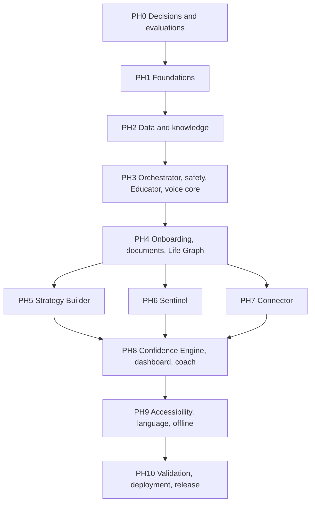

# Implementation Roadmap

**Last updated:** 2026-11-05 | **Status:** Phase 0 in progress (T0.06 done; D-029) | **Owner:** Sanket Mali

Implementation has not started. Tasks are in `TASK_TRACKER.md`. Acceptance criteria are in `01_REQUIREMENTS/ACCEPTANCE_CRITERIA.md`.

The hackathon's 24-hour plan no longer applies. This roadmap is for a solo-built, production-ready application using only free and open-source software (D-026).

## Gate rules

1. **No work starts until the plan is approved.**
2. **No PH1 until the PH0 gate passes.**
3. A phase is complete only when its acceptance criteria pass with evidence in `05_TESTING/`.
4. Finish a release's items before starting the next release's items.
5. Mock functionality never closes a phase. It is recorded in the tracker as MOCK.
6. Scope changes need an entry in `DECISIONS_LOG.md`.
7. Every new dependency or model needs a licence entry before it is added.
8. **No real user financial data until the legal gate in NFR-PRIV-03 passes.**

## Dependency map

PH5, PH6 and PH7 have no dependency on each other, but one developer will build them in sequence.

## Milestones

| Milestone | Scope | Exit test |
|---|---|---|
| **M1 First working journey** | Slice below, after PH7 core work | One user completes the journey end to end |
| **R1 Private beta** | All P0 items | Four persona journeys pass, using test data |
| **R2 v1.0** | All P1 items | Legal gate passed, hardware decided, security review closed |
| **R3 Post v1.0** | P2 items | Per feature |

### M1 slice

Keeps the hackathon's success metric: a real flow with a financial plan, scam detection and scheme discovery.

| # | Slice | Key items |
|---|---|---|
| 1 | Sign in, guided questionnaire, twin, baseline score | FR-ONB-01, FR-ASM-01..03, FR-FLG-03, FR-FCS-01..04 |
| 2 | Ask VAAKYA grounded answer with citations and safety | FR-EDU-01, FR-EDU-02, FR-SAF-01..04, FR-ORC-01 |
| 3 | Goal plan that works with irregular income | FR-STR-01, FR-STR-03..06 |
| 4 | Scam screenshot check | FR-SEN-01..06 |
| 5 | Scheme eligibility with reasons and steps, in Kannada | FR-CON-01..03, FR-CON-05, FR-CON-09 |
| 6 | Voice round trip in one regional language | FR-VOI-01..03 |
| 7 | Dashboard usable with a screen reader | FR-DSH-01, FR-A11-02, FR-A11-03 |

**Never traded away:** cross-user security, safety guardrails, scheme fact accuracy, calculator correctness, honest labelling.

## Effort

Rough solo estimates, assuming steady full-time work. Total is about 21-28 weeks to R1. Treat these as planning figures, because PH0 will refine them.

---

## PH0: Decisions and evaluations (2-3 weeks)

- **Objective:** Prove that the free, open-source stack works on the available hardware, before building on it.
- **Tasks:** T0.03, T0.04, T0.06 to T0.14. T0.01, T0.02 and T0.05 are dropped.
- **Dependencies:** Plan approval.
- **Files involved:** `02_ARCHITECTURE/evaluations/`, `05_TESTING/evaluations/`, `06_DOCUMENTATION/LICENCE_REGISTER.md`, `DECISIONS_LOG.md`.
- **Expected output:** Selected models and engines with measured quality, speed and memory; licence register; verified scheme fact sheet; measured GPU sharing plan.
- **Testing requirements:** Each evaluation records hardware, inputs, licence, latency and quality, in all four languages.
- **Acceptance criteria:**
  - A Private Tier and Reasoning Tier model are selected, with qualifying licences.
  - Speech input and output work in all four languages using open-licence engines, or a recorded fallback is accepted.
  - OCR is proven for Devanagari and Kannada.
  - All planned services run together on the host, within memory limits.
  - Scheme fact sheet is human-verified.

**If this phase fails:** If open models cannot reach usable quality on a 6 GB GPU, the options are better hardware or relaxing the free-and-open-source rule. Only the owner can make that call.

## PH1: Foundations (1-2 weeks)

- **Objective:** A running skeleton on which everything else depends.
- **Tasks:** T1.01 to T1.09.
- **Dependencies:** PH0 gate.
- **Files involved:** `04_APPLICATION/web/`, `api/`, `inference/`, `infra/compose.yaml`, lockfiles, Keycloak realm configuration, `.env.example`.
- **Expected output:** Installable PWA that signs in and calls a protected API, which calls a local LLM through the adapter, with monitoring running.
- **Testing requirements:** Auth route test, adapter contract test, secret scan, dependency and licence audit, clean rebuild from lockfiles.
- **Acceptance criteria:** FR-ONB-01, FR-OFF-01, FR-ORC-07, NFR-SEC-01, NFR-SEC-03, NFR-SEC-04, NFR-SEC-07, NFR-SEC-08, NFR-MAINT-01, NFR-MAINT-04, NFR-OBS-02, NFR-LIC-01.

## PH2: Data and knowledge (2-3 weeks)

- **Objective:** Data stores, trusted knowledge and seeded test users.
- **Tasks:** T2.01 to T2.07.
- **Dependencies:** PH1. T0.12 fact sheet.
- **Files involved:** `api/graph/`, `api/rag/`, `api/data/corpus_manifest.*`, `api/data/schemes.*`, database migrations, seed scripts.
- **Expected output:** PostgreSQL schema, Neo4j schema and gateway, Qdrant collection with sourced corpus, scheme catalogue, four test personas.
- **Testing requirements:** Cross-user graph test, retrieval smoke test, scheme data review, idempotent re-ingestion.
- **Acceptance criteria:** FR-FLG-01, FR-FLG-09, FR-KB-01 to FR-KB-03, FR-CON-01, NFR-SEC-02, NFR-ACC-01.

## PH3: Orchestrator, safety, Educator, voice core (3-4 weeks)

- **Objective:** One complete intelligent path with safety built in from the start.
- **Tasks:** T3.01 to T3.09.
- **Dependencies:** PH2. T0.03, T0.04, T0.07 and T0.08 results.
- **Files involved:** `api/orchestrator/`, `api/agents/educator/`, `api/safety/`, `api/llm/`, `inference/`, `web/app/ask/`.
- **Expected output:** A text or voice question gets a grounded, cited, translated and spoken answer, personalised by twin context, with requests queued fairly.
- **Testing requirements:** Routing, grounding, adversarial and identifier leakage sets; fault injection; egress test; screen-reader smoke test on chat.
- **Acceptance criteria:** FR-ORC-01, FR-ORC-02, FR-ORC-05, FR-FLG-07, FR-DL-01 to FR-DL-03, FR-DL-05, FR-SAF-01 to FR-SAF-04, FR-EDU-01, FR-EDU-02, FR-ASK-01, FR-VOI-01 to FR-VOI-03, FR-VOI-09, FR-LNG-02, FR-IMP-01, FR-DSH-05, NFR-SEC-06, NFR-ACC-06, NFR-PRIV-01, NFR-SCAL-03.

## PH4: Onboarding, documents, Life Graph (2-3 weeks)

- **Objective:** Users become a real twin.
- **Tasks:** T4.01 to T4.07.
- **Dependencies:** PH3.
- **Files involved:** `web/app/onboarding/`, `web/app/assessment/`, `api/documents/`, `api/ocr/`, `api/twin/`.
- **Expected output:** Both onboarding paths produce a populated Financial Life Graph.
- **Testing requirements:** Malformed files, extraction accuracy on samples, adaptive branch tests per persona.
- **Acceptance criteria:** FR-ONB-02 to FR-ONB-06, FR-DOC-01 to FR-DOC-06, FR-ASM-01 to FR-ASM-03, FR-FLG-02, FR-FLG-03, NFR-SEC-05.

## PH5: Strategy Builder (2 weeks)

- **Objective:** Correct plans that fit real income patterns.
- **Tasks:** T5.01 to T5.06.
- **Dependencies:** PH4.
- **Files involved:** `api/agents/strategy/`, `api/finance/`, `web/app/goals/`.
- **Expected output:** Goal Studio with feasibility, roadmap and progress, including variable and seasonal income.
- **Testing requirements:** Calculator unit tests with boundary cases; milestone sum check; plans for all three income patterns.
- **Acceptance criteria:** FR-STR-01, FR-STR-03 to FR-STR-06, FR-STR-08, FR-ASK-02.

## PH6: Sentinel (2 weeks)

- **Objective:** A trustworthy scam check with measured quality.
- **Tasks:** T6.01 to T6.06.
- **Dependencies:** PH4.
- **Files involved:** `api/agents/sentinel/`, `api/data/scam_patterns.*`, `web/app/scam/`, `05_TESTING/sentinel/`.
- **Expected output:** A screenshot or message produces a verdict with reasons and actions.
- **Testing requirements:** Labelled evaluation set, prompt-injection cases inside images and text.
- **Acceptance criteria:** FR-SEN-01 to FR-SEN-06, FR-SEN-08, FR-SEN-09. Published results for NFR-ACC-04.

## PH7: Connector (2 weeks)

- **Objective:** Correct eligibility with guidance a farmer can follow.
- **Tasks:** T7.01 to T7.07.
- **Dependencies:** PH2 catalogue, PH4 twin.
- **Files involved:** `api/agents/connector/`, `api/eligibility/`, `web/app/schemes/`.
- **Expected output:** Scheme discovery, per-criterion eligibility and application steps, plus the Kannada farmer flow.
- **Testing requirements:** Table-driven rule tests, including age boundaries and exclusions; content review.
- **Acceptance criteria:** FR-CON-02, FR-CON-03, FR-CON-05, FR-CON-09.

## PH8: Confidence Engine, dashboard, coach (3 weeks)

- **Objective:** Connect everything into one measurable experience.
- **Tasks:** T8.01 to T8.09.
- **Dependencies:** PH5, PH6, PH7.
- **Files involved:** `api/score/`, `api/review/`, `api/scheduler/`, `web/app/dashboard/`, `web/app/score/`, `web/app/graph/`, `web/app/learn/`.
- **Expected output:** Live score, dashboard, Life Graph, learning, monthly review, data controls.
- **Testing requirements:** Formula fixtures, event-to-score tests, cross-screen reconciliation, deletion tests.
- **Acceptance criteria:** FR-ASM-05, FR-FCS-01 to FR-FCS-04, FR-DSH-01, FR-SAF-06, NFR-PRIV-02.

## PH9: Accessibility, language, offline hardening (2-3 weeks)

- **Objective:** Prove the inclusion claims. Semantic structure should already exist from PH3.
- **Tasks:** T9.01 to T9.05.
- **Dependencies:** PH8.
- **Files involved:** `web/messages/`, `web/components/a11y/`, `web/public/`, `05_TESTING/accessibility/`.
- **Expected output:** All P0 screens in four languages and fully usable with a screen reader.
- **Testing requirements:** axe-core, TalkBack and NVDA scripts, Divya's complete journey, Android font check.
- **Acceptance criteria:** FR-A11-02, FR-A11-03, FR-LNG-01, FR-VOI-07, NFR-A11Y-01 to NFR-A11Y-03, NFR-I18N-01.

## PH10: Validation, production deployment, release (2-3 weeks)

- **Objective:** A reliable release with honest documentation.
- **Tasks:** T10.01 to T10.08.
- **Dependencies:** PH9.
- **Files involved:** `04_APPLICATION/infra/`, `05_TESTING/`, `06_DOCUMENTATION/`, `02_ARCHITECTURE/`, `08_HANDOVER/`, `README.md`.
- **Expected output:** R1 deployed, with evidence and the maintained documentation set.
- **Testing requirements:** All persona scenarios, reconciliation, performance, device test, rollback rehearsal, backup restore, blocked-internet test, licence report, security review.
- **Acceptance criteria:** AC-P1 to AC-P4, NFR-AVAIL-02, NFR-ACC-02, NFR-COMP-01, NFR-SEC-10, NFR-LIC-02. Every public claim is true of the build.

---

## Requirement-to-phase check

Every P0, P1 and P2 requirement has a phase and at least one task, confirmed by the check run on 2026-11-05. P3 items are unscheduled.
