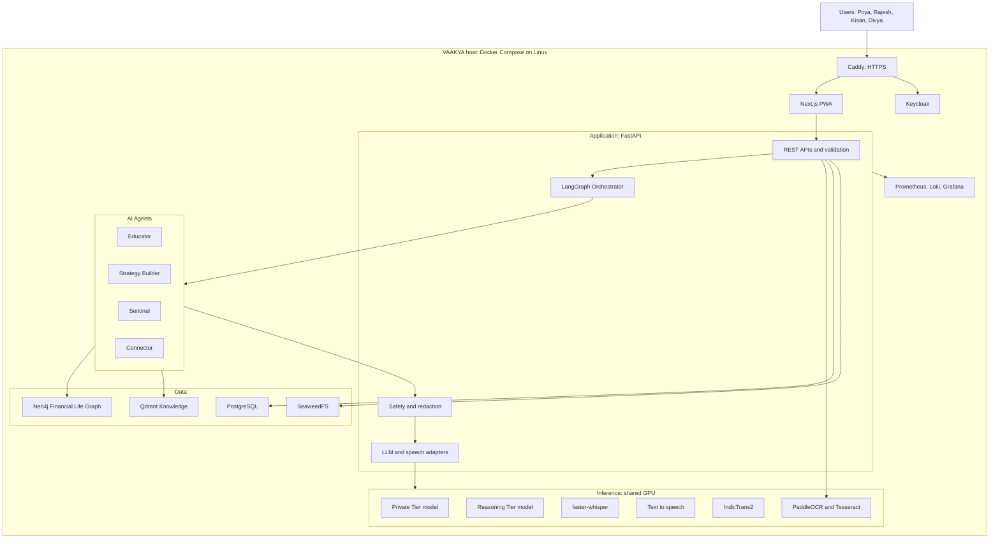
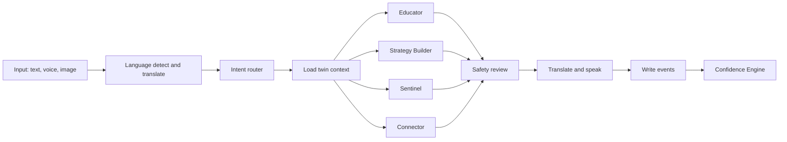
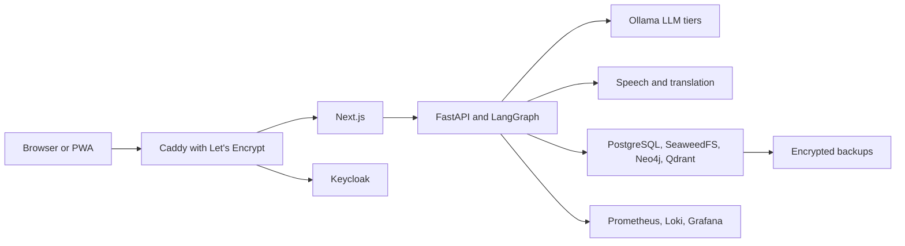

# VAAKYA Master Plan

**Product:** VAAKYA - AI Financial Guardian
**Tagline:** AI Agents for Financial Empowerment
**Owner:** Sanket Mali
**Origin:** Built from the Nomura KakushIN 2026 hackathon concept. The hackathon is complete.
**Goal:** A fully functional, production-ready application, using only free and open-source software.
**Plan status:** Phase 0 in progress (D-029, owner to confirm). Detailed architecture: `02_ARCHITECTURE/`
**Last updated:** 2026-11-05

> **No application code exists.** Phase 0 evaluations and the architecture set exist. PH1 starts only after the Phase 0 gate.

> **Design constraint:** everything must be free and open source (D-026). Firebase, AWS and paid LLM APIs from the original documents are replaced with self-hosted open-source components.

## How to read this plan

| Label | Meaning |
|---|---|
| **[Source]** | Stated in the problem statement or the team's documents |
| **[ER]** | Engineering recommendation from planning. Not in any source document. |
| **[Gap]** | The sources promise something that nothing currently delivers |

This plan summarises. The detail lives in one place each:

| Topic | Single source of truth |
|---|---|
| What to build | `01_REQUIREMENTS/FUNCTIONAL_REQUIREMENTS.md`, `NON_FUNCTIONAL_REQUIREMENTS.md` |
| When it is done | `01_REQUIREMENTS/ACCEPTANCE_CRITERIA.md` |
| Feature status | `00_PROJECT_MANAGEMENT/FEATURE_TRACKER.md` |
| Order of work | `00_PROJECT_MANAGEMENT/IMPLEMENTATION_ROADMAP.md` |
| Task status | `00_PROJECT_MANAGEMENT/TASK_TRACKER.md` |
| Decisions, conflicts, open questions | `00_PROJECT_MANAGEMENT/DECISIONS_LOG.md` |
| Current state | `00_PROJECT_MANAGEMENT/CURRENT_STATUS.md` |

---

## 1. Project overview

VAAKYA is a multi-agent financial companion that proactively educates, protects, plans and connects users throughout their financial journey. **[Source]**

It combines Agentic AI, financial knowledge retrieval, accessibility-first design, scam prevention and personalised financial planning. Its core is a Financial Life Graph, a living model of each user's finances, goals, learning, risk and scheme eligibility. **[Source]**

**Core innovations** **[Source: brief, Executive Summary]**

1. Four specialized AI agents
2. Financial Life Graph
3. Financial Confidence Score
4. Dual-LLM architecture
5. Accessibility-first financial guidance
6. Scam prevention system
7. Government scheme discovery
8. Behavioral impact measurement

**Project direction** **[Owner, 2026-11-05]:** The hackathon is finished. VAAKYA continues as an independent, production-ready application with no competition constraints. All software must be free and open source. The Problem Statement and Executive Summary remain the primary references for the problem and solution. Where the Executive Summary names proprietary vendors, the open-source decisions in `DECISIONS_LOG.md` take precedence (C-032).

## 2. Problem understanding

The challenge is to "develop an Agentic AI-powered solution that democratizes financial literacy and empowers individuals across diverse economic backgrounds, abilities, and contexts". **[Source]**

India has wide digital financial access, but understanding has not kept up. The team's insight is: **"India's next financial inclusion challenge is not access to financial services, it is access to financial confidence."** **[Source]**

Its outcomes are explicitly **"illustrative guidelines, not requirements"**, and it asks for "innovative thinking, not checkbox implementations".

Full analysis: `01_REQUIREMENTS/PROBLEM_ANALYSIS.md`.

## 3. Proposed solution

One platform with four pillars: **Learn, Plan, Protect, Grow**. **[Source: deck s9]**

| Agent | Purpose | Mode (ES Appendix A) | Core tools |
|---|---|---|---|
| Educator | Personalised literacy, investment education, simple explanations | Reactive | RAG over LlamaIndex and Qdrant, LLM |
| Strategy Builder | Roadmaps, savings plans, goal strategies | Proactive and Reactive | Financial Life Graph, LLM |
| Sentinel | Scam, fraud and predatory loan protection | Reactive | PaddleOCR, LLM |
| Connector | Scheme discovery, eligibility, benefits, application guidance | Reactive | Neo4j profile, Qdrant scheme knowledge |

The agent is the **Strategy Builder Agent**. "Guardian" belongs to the product identity (D-004).

## 4. The four personas

Source of record is the problem statement. Details and gaps: `01_REQUIREMENTS/PERSONA_ANALYSIS.md`.

| Persona | Who | Core need | Language | Lead agents |
|---|---|---|---|---|
| Priya | 32, school teacher, Thane, ₹35,000/month | Trusted plain-language guidance; evaluate products sold to her | Marathi | Educator, Sentinel |
| Rajesh | 24, gig worker, Mumbai, ₹15,000-40,000/month variable | Irregular income planning, emergency fund, avoid loan traps | Not stated | Strategy Builder, Sentinel |
| Kisan | 45, farmer, rural Karnataka, 3 acres, seasonal | Scheme access, seasonal planning | Kannada | Connector, Strategy Builder |
| Divya | 28, visually impaired content writer, Pune, ₹25,000/month | Voice and screen-reader access, financial independence, disability schemes | Not stated | All, through voice |

## 5. Complete feature inventory

208 tracked items: 159 functional and 49 non-functional, across 23 functional modules. Full list in `FEATURE_TRACKER.md`.

| Priority | Count | Meaning |
|---|---|---|
| P0 | 113 | Required for Release 1, private beta |
| P1 | 59 | Required for Release 2, v1.0 |
| P2 | 27 | Release 3, after v1.0 |
| P3 | 9 | Vision only, unscheduled |

| Area | Modules |
|---|---|
| Entry and data capture | Onboarding, Document Intelligence, Assessment |
| Intelligence core | Financial Life Graph, Confidence Score, Orchestration, Dual-LLM, Knowledge Base |
| Agents and experiences | Ask VAAKYA, Educator, Strategy Builder, Sentinel, Connector |
| Continuity | Dashboard, Monthly Coach, Engagement, Impact |
| Inclusion | Voice, Accessibility, Language, PWA and Offline |
| Trust | Responsible AI |
| Future | Ecosystem and business |

**Screens planned, from the 16 mockups:** Landing, Assessment, Dashboard, Goal Studio, Ask VAAKYA, Scam Detection, Scam Knowledge Center, Government Schemes, Scheme Eligibility, Learning Academy, Life Graph, Confidence Score, Opportunities, Monthly Report, Voice Companion.

## 6. Functional requirements

Defined in `FUNCTIONAL_REQUIREMENTS.md`. Traceability tables there show that every one of the 32 problem statement items, 28 persona needs and 8 core innovations maps to at least one requirement.

Rules that shape all requirements:

- **Deterministic core** **[ER, D-013]:** money calculations, eligibility and the confidence score are code. LLMs explain and personalise.
- **Educational positioning** **[Source: s8, D-017]:** VAAKYA explains options; the user decides.
- **Honest labelling:** any sample data is labelled as such.

## 7. Non-functional requirements

Defined in `NON_FUNCTIONAL_REQUIREMENTS.md`. Sources give almost no measurable targets, so every number there is an **[ER]** proposal.

Headline targets: text answer under 20 s and voice round trip under 45 s on the target hardware, WCAG 2.2 AA on P0 screens, tested with TalkBack and NVDA, zero cross-user data access, no user data leaving the host, and a passing licence check on every component and model.

Latency targets are provisional, because they depend on the 6 GB GPU. Phase 0 will replace them with measured figures.

## 8. User journeys

### Primary journey, 14 steps [Source: deck s11]


### Flows into the Confidence Engine [Source: deck s29]

| Flow | Trigger | Agent | Result |
|---|---|---|---|
| Assessment | User opens VAAKYA | - | Profile created, score generated |
| Educator | User asks a question | Educator | Guidance delivered, progress updated |
| Strategy | User creates a goal | Strategy Builder | Plan generated, progress tracked |
| Sentinel | User uploads a suspicious message | Sentinel | Risk analysed, safety advice delivered |
| Connector | User asks, or system detects eligibility | Connector | Eligible schemes found, application guidance given |

All flows feed the Financial Confidence Engine, which updates the score.

### Retention loop [Source: deck s25]

Learning, Goals, Reviews, Opportunities, Protection, Return.

### Persona journeys [ER]

Defined as AC-P1 to AC-P4 in `ACCEPTANCE_CRITERIA.md`. Divya's path is voice and screen reader only.

## 9. Technology stack

Every component below is free of charge and open source. Licences marked *confirm* are recorded from secondary sources or general knowledge, and must be verified in the licence register (T0.06).

| Layer | Original document | Planned, self-hosted | Licence |
|---|---|---|---|
| Frontend | Next.js, TypeScript, Tailwind, ShadCN UI, PWA | Same, at current stable versions | MIT or Apache-2.0, *confirm* |
| Backend | FastAPI, Python | Same, at current stable versions | MIT, PSF |
| Orchestration | LangGraph | Same | MIT, *confirm* |
| LLM runtime | Gemini 2.5 Pro or KakushIN LLM | **Ollama** | MIT, *confirm* |
| LLM models | Same | **Open-licence models, chosen by T0.03** | Apache-2.0 or MIT required |
| Retrieval | Qdrant, LlamaIndex, multilingual-e5-large | Same | Apache-2.0, MIT, MIT, *confirm* |
| App database | Cloud Firestore | **PostgreSQL** | PostgreSQL License |
| Graph database | Neo4j Community | Same | GPLv3, *confirm* |
| File storage | Firebase Storage | **SeaweedFS** | Apache-2.0, *confirm* |
| Authentication | Firebase Authentication | **Keycloak** | Apache-2.0, *confirm* |
| Speech-to-text | Whisper Large-v3 | Same, through **faster-whisper** | MIT, *confirm* |
| Text-to-speech | Coqui TTS 0.22 | **Indic Parler-TTS**, with **eSpeak NG** as fallback | Apache-2.0 reported, must verify; GPLv3 |
| Translation | IndicTrans2 | Same, pinned to a commit | MIT |
| OCR | PaddleOCR | Same, plus **Tesseract** as fallback for Kannada | Apache-2.0, *confirm* |
| PII redaction | Not declared | **Microsoft Presidio** | MIT, *confirm* |
| Scheduler | Not declared | **APScheduler** | MIT, *confirm* |
| Email | Amazon SES | **Self-hosted SMTP**, Release 3 | Open source, choose later |
| Containers | Docker, ECS Fargate | **Docker Engine with Compose** | Apache-2.0 |
| Web entry | ALB, CloudFront | **Caddy** with Let's Encrypt | Apache-2.0 |
| Monitoring | CloudWatch | **OpenTelemetry, Prometheus, Loki, Grafana** | Apache-2.0, AGPLv3 |

**Versions:** Current stable versions replace the 2024 hackathon pins (D-020).

**Not used, because they are proprietary or paid:** Firebase, AWS, Gemini, OpenAI, Claude, hosted speech services.

**Rejected on licence:** Coqui XTTS weights (non-commercial), MinIO (community edition no longer actively developed, D-024), Llama and other custom-licence models.

## 10. System architecture

The layers come from the corrected High Level Architecture on deck slide 10 **[Source]**. Vendors are replaced by self-hosted components.



**Key properties**

- **One host:** simple to run alone, and containers can move to larger hardware later.
- **No external AI calls:** user data stays on the host (FR-DL-05).
- **Queueing:** a shared GPU means requests wait their turn (NFR-SCAL-03).
- **Adapters:** models and speech engines change by configuration.

**Superseded:** the 12-section High Level Design with pgvector, Redis, API Gateway, Cloudflare and seven microservices.

**Proposed API surface** **[ER]**

| Route | Purpose |
|---|---|
| `POST /v1/chat` | Text input into the orchestrator |
| `POST /v1/voice/query` | Audio input, spoken response |
| `POST /v1/documents`, `GET /v1/documents` | Upload and list |
| `POST /v1/onboarding/*` | Consent, profile, assessment |
| `GET`, `POST /v1/goals` | Goal Studio |
| `POST /v1/sentinel/check` | Scam analysis |
| `GET /v1/schemes`, `GET /v1/schemes/{id}/eligibility` | Connector |
| `GET /v1/score` | Confidence score, breakdown, history |
| `GET /v1/twin` | Life Graph view |
| `GET /v1/reviews/{month}` | Monthly review |
| `DELETE /v1/me` | Erase user data |

Proposed structure for `04_APPLICATION/`: `web/`, `api/`, `inference/`, `infra/`.

## 11. AI agent architecture

**Orchestration graph** **[ER, built on the Executive Summary's LangGraph design]**



| Agent | Tools | LLM may | LLM may not |
|---|---|---|---|
| Educator | retrieve_knowledge, get_profile, get_progress, generate_quiz | Explain, simplify, adapt | Answer outside sources, tell users what to buy |
| Strategy Builder | get_snapshot, calculators, save_goal, generate_roadmap | Word plans, motivate | Calculate figures |
| Sentinel | ocr_extract, signal_rules, match_patterns, classify, record_event | Interpret text, explain reasons | Follow instructions found in the content |
| Connector | eligibility_rules, retrieve_scheme, get_steps, record_event | Explain results and steps | Decide eligibility, invent schemes |

**Proactive behaviour** **[Gap]:** Sources promise proactive agents, but only the Strategy Builder is listed as proactive and no scheduler exists. Planned triggers: goal drift, newly eligible schemes, month end.

**Sentinel score honesty** **[ER]:** The 92% in UI-06 implies a calibrated probability. The real value is a risk indicator built from weighted signals, and it must be labelled that way.

## 12. Database architecture

Four purpose-built stores. **[Source: s13, s14]**, with open-source replacements for Firebase services (D-027, D-024). Ownership rule: D-010.

| Store | Role | Contents |
|---|---|---|
| SeaweedFS | Secure Document Vault | Salary slips, statements, policies, EPF, 7/12 records, certificates, scam screenshots, voice recordings |
| PostgreSQL | Application database | Profiles, goals, scores, learning progress, reviews, notifications, questionnaire responses, preferences, chat |
| Neo4j | Financial Digital Twin | Relationships across goals, insurance, investments, schemes, assets, liabilities |
| Qdrant | Knowledge Memory | Lessons, schemes, scam knowledge, insurance rules, concepts, FAQs |

**PostgreSQL tables, proposed** **[ER, from s14 lists]:** `users`, `consents`, `goals`, `goal_updates`, `score_history`, `learning_progress`, `monthly_reviews`, `notifications`, `questionnaire_responses`, `conversations`, `events`.

**Storage path** **[Source: s14]:** `vaakya-user-docs/{userId}/{year}/{month}/`, kept on SeaweedFS.

**Qdrant** **[Source: s14, corrected]:** collection `financial_knowledge`, HNSW index, 1024 dimensions, payload `category`, `language`, `source`, `publisher`, `effective_date`, `scheme_id`.

**Notes** **[ER]:** Neo4j Community has no multi-database or role-based isolation, so isolation is enforced in the gateway (FR-FLG-09). Qdrant holds no personal data.

## 13. Financial Life Graph

A "living, dynamic representation of every user's financial life". **[Source: s13]**

**Lifecycle:** Create, Enrich, Analyze, Act and Guide, Evolve. **[Source]**

```cypher
(:User)-[:PURSUES]->(:Goal)-[:HAS]->(:Milestone)
(:Goal)-[:REQUIRES]->(:Investment)
(:User)-[:OWNS]->(:InsurancePolicy)-[:COVERS]->(:PersonOrAsset)
(:InsurancePolicy)-[:DUE_FOR]->(:PremiumPayment)
(:User)-[:ELIGIBLE_FOR]->(:Scheme)-[:PROVIDES]->(:Benefit)
(:Scheme)-[:ISSUED_BY]->(:Authority)
```

The three chains above are from slide 13 **[Source]**. Income, Liability, Banking, Risk, learning and scam history nodes are named on other slides, and their relationships are to be designed in PH2 **[ER]**.

**Limit to state plainly** **[Gap]:** slide 13 says the twin is enriched from transactions and market data. No source defines how, so that item is backlog (FR-FLG-05). The demo twin is built from documents, answers and in-app actions.

**Why a graph** **[Source]:** relationships between goals, policies and schemes are central, and traversal supports context for agents.

## 14. Financial Confidence Score

**Definition [Source]:** measures financial literacy, savings behaviour, scam awareness and goal progression. UI-10 shows 0-100 overall, with a fifth dimension, scheme awareness.

**Proposed specification [ER, D-011]. Not in any source.**

```text
FCS = round( mean(Literacy, Safety, GoalPlanning, SchemeAwareness, SavingsDiscipline) )
```

| Dimension | Proposed inputs, each scaled 0-100 |
|---|---|
| Financial Literacy | 60% quiz accuracy, 40% core module completion |
| Financial Safety | 50% scam quiz accuracy, 30% Digital Safety module, 20% capped scam checks |
| Goal Planning | 50% has a funded priority goal, 50% goals on track against milestones |
| Scheme Awareness | Share of eligible schemes reviewed; bonus for application started |
| Savings Discipline | Months hitting planned saving in the last three, using a floor-based target for variable income |

| Band | Range |
|---|---|
| Excellent | 85-100 |
| Good | 70-84 |
| Fair | 50-69 |
| Building | 0-49 |

These bands fit the sample labels in UI-10. Check: (82 + 90 + 75 + 68 + 76) / 5 = 78.2, which gives 78, matching UI-10.

**Principles [ER]:** versioned formula; every change has a stored reason; capped activity so it cannot be farmed; never presented as a credit score; low-income users are not penalised for income level. Weightings need team approval and validation.

## 15. Dual-LLM architecture

**Source claim:** "sensitive data stays on-device while complex reasoning is handled by the cloud AI."

**Decision (D-003):** Keep two tiers. Because everything must be free and open source, both are self-hosted.

| | Private Tier | Reasoning Tier |
|---|---|---|
| Runs | Small open model plus rules, on the VAAKYA host | Larger open model, on the VAAKYA host |
| Sees | OCR text, identifiers, transcripts | Redacted structured context and retrieved public knowledge |
| Does | PII redaction, field extraction, simple classification | Reasoning, planning explanations, scam analysis, multi-agent workflows |

**Flow:** raw data enters the Private Tier, identifiers are replaced with tokens, the Reasoning Tier sees minimum context, and tokens are restored in the response. The audit log records which field categories passed between tiers (FR-DL-04).

**Trade-off to accept:** Privacy is stronger than the original design, because nothing leaves the host. Reasoning is weaker than frontier cloud models. A 6 GB GPU limits model size. The deterministic core (D-013) keeps money figures and eligibility correct regardless of model strength, and T0.03 will show what quality is achievable.

**Wording:** say "processed on VAAKYA's own server". Do not say "on-device".

## 16. Security and privacy

**Source commitments:** raw documents encrypted; only structured insights used for AI; users consent to storage and processing. Sources also claim AES-256 and "bank-grade" encryption. Do not repeat these claims unless they are true of the built system.

**Controls** **[ER unless marked]**

| Area | Control |
|---|---|
| Identity | Keycloak OIDC token verified on every API route |
| Authorisation | User scoping in the API, PostgreSQL row checks, storage paths, Neo4j gateway and agent tools |
| Data in AI | Redaction, minimal context, no raw documents to the Reasoning Tier **[Source]**, no external AI calls |
| Prompt injection | Documents, OCR and retrieved text treated as data. Essential for Sentinel, which reads attacker-written content. |
| Uploads | Type and size checks, 10 MB limit **[Source: UI-06]** |
| Secrets | Docker secrets. Nothing in the repository. |
| Logs | No raw PII or financial values |
| Voice | Audio deleted after transcription by default |
| User rights | View, export, delete (FR-SAF-06) |
| Dependencies | Audited, patched, pinned |

**Regulatory awareness.** Not legal advice.

- **DPDP Act and Rules:** notified 13 Nov 2025, phased, with full compliance around May 2027. Design for consent, notice and erasure.
- **SEBI:** personalised investment advice may need registration. Stay educational (D-017).
- **Referral revenue (s26):** a future idea that creates a conflict of interest. The source principle, "Revenue never influences advice", must be enforced if it is ever built.

## 17. Accessibility

Accessibility is a headline innovation, so it is a P0 concern, not a final polish phase.

**Source commitments:** voice-based interaction, support for visually impaired and low-literacy users, screen-reader native, Voice Navigation, Voice Explain and Voice Summary on each screen. Pain points name "tiny buttons, charts, complex interfaces".

| Principle | Requirement |
|---|---|
| Standard | WCAG 2.2 AA on P0 screens **[ER]** |
| No chart dependency | Every gauge, ring and chart has a text and spoken equivalent |
| Assistive technology | Real tests with TalkBack and NVDA |
| Target size | 44 by 44 px minimum |
| Colour | Never the only signal |
| Language | Noto fonts for Devanagari and Kannada; lakh and crore read aloud correctly |
| Low literacy | Simple words, icons, voice for every step |
| Private input | Divya can enter sensitive data without assistance |
| Dynamic content | Streaming answers and verdicts announced through live regions |

**Rule:** build semantic structure from PH3 onward. PH9 is hardening, and retrofitting there would be too late.

**Text-to-speech independence:** Divya's own screen reader reads the interface, so accessibility must not depend on VAAKYA's own speech engine.

**Gap:** no real users with visual impairment are involved. Automated tests and developer testing do not replace that. Recruit one tester if possible.

## 18. Testing strategy

| Level | Tooling [ER] | Scope |
|---|---|---|
| Unit | pytest, Vitest | Calculators, eligibility, score formula, redaction |
| Contract | pytest | LLM adapter for every provider |
| Integration | pytest with Docker services | Agents with Neo4j, Qdrant, PostgreSQL, SeaweedFS, Keycloak |
| Agent evaluation | Custom labelled sets | Routing, grounding, safety, scam detection |
| End-to-end | Playwright | Four persona scenarios |
| Accessibility | axe-core, Lighthouse, manual TalkBack and NVDA | P0 screens |
| Security | Cross-user tests, secret scan, npm and pip audit, licence scan, blocked-internet test | All stores |
| Performance | Scripted timing | NFR-PERF items |
| Reconciliation | Automated | Same number on every screen |

**Evaluation sets to build:** 40 routing prompts, 30 RAG questions per language, 30 scam and 30 genuine messages, an adversarial safety set, an identifier leakage set, and eligibility boundary tables.

**Evidence** lives in `05_TESTING/`. Report real results, even when weak.

## 19. Deployment strategy

| Environment | Purpose | Shape |
|---|---|---|
| Local | Development | Docker Compose on the development machine |
| Staging | Release testing | Same Compose file with production settings |
| Production | Live service | Docker Compose on a Linux host with a GPU |



**Free today:** development, testing and private demonstrations on your laptop, at no software cost.

**Honest limit:** A public service needs an always-on machine with a GPU and internet access. Software can be free, but hardware, electricity and a domain name are not. A laptop suits only a small private test. Decide on hardware before Release 2.

**Rules [ER]:** deployments are scripted; backups are encrypted and restores rehearsed; model weights are stored locally; the system must pass a blocked-internet test (NFR-LIC-02).

## 20. Development phases

Full detail: `IMPLEMENTATION_ROADMAP.md`. Effort figures are rough solo estimates.

| Phase | Name | Estimate |
|---|---|---|
| PH0 | Decisions and evaluations | 2-3 weeks |
| PH1 | Foundations | 1-2 weeks |
| PH2 | Data and knowledge | 2-3 weeks |
| PH3 | Orchestrator, safety, Educator, voice core | 3-4 weeks |
| PH4 | Onboarding, documents, Life Graph | 2-3 weeks |
| PH5 | Strategy Builder | 2 weeks |
| PH6 | Sentinel | 2 weeks |
| PH7 | Connector | 2 weeks |
| PH8 | Confidence Engine, dashboard, coach | 3 weeks |
| PH9 | Accessibility, language, offline hardening | 2-3 weeks |
| PH10 | Validation, production deployment, release | 2-3 weeks |

| Milestone | Scope |
|---|---|
| M1 First working journey | The original hackathon success metric, end to end |
| R1 Private beta | All P0 items |
| R2 v1.0 | All P1 items, after the legal gate |
| R3 Post v1.0 | P2 items |

## 21. Risk management

Scale: Likelihood (L) and Impact (I), High, Medium or Low. Sanket Mali owns all risks.

| ID | Risk | L | I | Mitigation |
|---|---|---|---|---|
| R-01 | Open models on 6 GB give weak reasoning or poor Indian-language quality | H | H | T0.03 evaluation, deterministic core, English pivot, plain and bounded prompts |
| R-02 | A single 6 GB GPU cannot share LLM, speech and translation with usable speed | H | H | Measure early, queueing, model loading rules, CPU for some services, larger hardware later |
| R-03 | Scope is very large for one developer: 113 P0 items | H | H | Milestone M1 first, strict phase gates, P2 deferred |
| R-04 | No acceptable open-licence Kannada or Marathi text-to-speech | H | H | T0.07, eSpeak NG baseline, screen reader support, typed output always works |
| R-05 | Public launch needs paid hardware, despite free software | H | M | State it plainly; decide before R2; keep host requirements documented |
| R-06 | Kannada OCR is weak in PaddleOCR | M | M | T0.13, Tesseract fallback, user confirmation, questionnaire path |
| R-07 | Licence of a key model or component does not qualify | M | H | Licence register, automated check, alternatives listed |
| R-08 | Wrong scheme or financial information harms users | M | H | Verified fact sheet, rules engine, citations |
| R-09 | LLM produces harmful or overconfident advice | M | H | Safety layer, adversarial tests, educational stance. Weaker models make this more important. |
| R-10 | Prompt injection through scam content or documents | M | H | Data-only handling, tests |
| R-11 | Data loss on a single host | M | H | Encrypted backups, restore rehearsal |
| R-12 | Single host is a single point of failure | H | M | Monitoring, documented recovery, clear service status |
| R-13 | Corpus or scheme data is missing or stale | M | M | Manifest, freshness labels |
| R-14 | Weak retrieval in Indian languages | M | M | Translate-first comparison (T0.10) |
| R-15 | Regulatory exposure with real users | M | H | D-017, no real data before advice |
| R-16 | Accessibility left too late | M | H | Build semantics from PH3 |
| R-17 | Self-hosted email has poor delivery | H | L | In-app review is the primary channel |
| R-18 | Project depends on one person | M | H | Documentation, handover, small milestones |
| R-19 | Self-hosting security burden: patches, exposed services, backups | M | H | Minimal exposed ports, update routine, security review |

**External dependencies**

| Dependency | Needed for | Status |
|---|---|---|
| Open model weights | LLM, speech, translation | Download and store locally |
| Language and scheme sources | RBI, SEBI and government documents | Not collected |
| Official scheme portals | Fact verification | Not started |
| Google sign-in | Optional login | Not required |
| Let's Encrypt | Free HTTPS for public hosting | Needs a domain name |
| Target hardware | Production | Laptop for now |
| Assistive-technology testers | Accessibility truth | None identified |
| Legal adviser | Real user data | None identified |

## 22. Project deliverables

The hackathon is complete, so its submission list no longer applies. The owner asked for a maintained documentation set.

| Deliverable | Location | Status |
|---|---|---|
| Working application | `04_APPLICATION/` | Not started |
| Project README | Repository root | Not started |
| Technical architecture | `02_ARCHITECTURE/` | Summary in this plan |
| System design diagrams | `02_ARCHITECTURE/` | Not started |
| Database schemas | `02_ARCHITECTURE/` | Not started |
| API documentation | `06_DOCUMENTATION/` | Not started |
| AI agent workflows | `02_ARCHITECTURE/` | Not started |
| Development roadmap | `00_PROJECT_MANAGEMENT/` | Complete, awaiting approval |
| Deployment documentation | `06_DOCUMENTATION/` | Not started |
| Licence register | `06_DOCUMENTATION/` | Not started |
| Test and evaluation reports | `05_TESTING/` | Not started |
| Hackathon archive | `07_HACKATHON_DELIVERABLES/` | Original material stays in `NOMURA/` |
| Final handover | `08_HANDOVER/` | Not started |

---

## Appendix A: Source register

All material in `NOMURA/` was reviewed on 2026-11-05: 2 primary documents, 2 decks, 34 images, 20 deck-only images. The PDF and both decks were read **visually** because they contain almost no extractable text (the PDF yields 126 characters; the decks have none).

### Primary and deck files

| File | Type | Role | Notes |
|---|---|---|---|
| `INVINCIBLES/KakushIN Problem Statement_.pdf` | 6 pages, image-based | Primary | Cover, theme, 4 personas, problem statement, outcomes, image credits |
| `INVINCIBLES/` Executive Summary (Word file) | Word | Primary | Round 1, June 2026; 2 embedded diagrams. Brief names it with a `-1` suffix that does not exist. |
| `FINAL SUBMISSION ALL.pptx` | 31 slides | Latest deck, 23 Jun 06:59 | Includes the UI section. Referred to as `DK-sN`. |
| `FINAL PPT.pptx` | 22 slides | Earlier deck, 23 Jun 06:34 | Subset, no UI section. Slide 9 shows superseded HLD. |

### Slide map, `FINAL SUBMISSION ALL.pptx`

| Slide | Content | Image |
|---|---|---|
| 1 | Cover | `PAGE NO 1.png` |
| 2 | Table of contents | `TOC.png` |
| 3 | Problem Understanding | `Problem Understanding.png` |
| 4 | The Problem in Numbers | Deck only |
| 5 | Key Pain Points | `PAIN POINTS.png` |
| 6 | User Personas | `user personas.png` |
| 7 | Market and Competitive Landscape | `TAM SOM.png` |
| 8 | Key Assumptions | `KEY ASSUMPTIONS.png` |
| 9 | Introducing VAAKYA | `INTRO AND VISION.png` |
| 10 | High Level Architecture, covers `HLD new slide.png` | Deck only |
| 11 | User Journey | `USER Joureney.png` |
| 12 | Onboarding Intelligence Engine | `Onboarding intelligence engine.png` |
| 13 | The Heart of VAAKYA | `Heart Of vakkay Digital twin.png` |
| 14 | Financial Intelligence Data Architecture | `dbsfinal.png` |
| 15 | AI Intelligence | `AI intelligence.png` |
| 16-23 | UI mockups, UI-01 to UI-16 | Deck only (below) |
| 24 | User Experience and Engagement | `UX.png` |
| 25 | User Retention Flywheel | `User retention.png` |
| 26 | Business Model and Ecosystem Value | `Bussiness Model And EcoSystem.png` |
| 27 | Tech Stack | `TECH STACK.png` |
| 28 | Implementation Plan, 24 hours | `24 hours implementation plan.png` |
| 29 | Overall System Flow | `SYSTEM FLOW.png` |
| 30 | About Us | `about us.png` |
| 31 | Thank You and Team Roles | `Thank you.png` |

### UI mockup register

Design images, not product screenshots (D-023).

| ID | Slide | Screen | Key content |
|---|---|---|---|
| UI-01 | 16 | Landing | English, Hindi, Marathi; Start Financial Assessment; Try Voice Mode; trust badges |
| UI-02 | 16 | Financial Assessment | 5 steps, salary slip extraction, income, goals, risk slider, tap to speak |
| UI-03 | 17 | Goal Studio | Emergency fund, feasibility gauge, recommended timeline, roadmap |
| UI-04 | 17 | Home Dashboard | Score, snapshot, risk, goals, AI insight, opportunity, activity, streak |
| UI-05 | 18 | Ask VAAKYA | Suggested prompts, "Why this recommendation?" |
| UI-06 | 18 | Scam Detection | Upload, risk score, reasons, matched pattern, actions |
| UI-07 | 19 | Government Schemes | Search, filters, eligibility badges, match percentages |
| UI-08 | 19 | Learning Academy | Level, XP, streak, 6 modules, daily challenge, stats |
| UI-09 | 20 | Financial Life Graph v1 | Vertical node chain, insights |
| UI-10 | 20 | Financial Confidence Score | 5-dimension breakdown, improvement actions, "updated every 7 days" |
| UI-11 | 21 | Opportunities For You | Schemes, 80C, emergency gap, lesson, AI summary |
| UI-12 | 21 | PMJJBY Eligibility | Criterion checklist, AI explanation, application CTA |
| UI-13 | 22 | June Financial Report | Snapshot, achievements, spending, alerts, focus |
| UI-14 | 22 | Voice Companion | Listening state, language, recent conversations |
| UI-15 | 23 | Scam Knowledge Center | Patterns, tips, alert feed |
| UI-16 | 23 | Financial Life Graph v2 | Fuller chain with scheme links |

### Other images

| File | Role |
|---|---|
| `HLD new slide.png`, `HLD new.png` | Superseded 12-section HLD with pgvector and extra infrastructure |
| `HLD.png` | Technology Dependency Map, also embedded in the Executive Summary |
| `dbs.png` | Earlier four-store data architecture. Includes Neo4j and uses "Guardian". |
| `dbs2.png` | Earlier three-store version |
| `IMPLIMENTATION PLAN.png` | Near-duplicate of the 24-hour plan |
| `USER ACTIVITY.png` | Light-theme version of System Flow |
| Three WhatsApp JPEGs dated 2026-06-21 (2.49.23 PM, 2.49.23 PMjhgjh, 2.49.278 PM) | Earlier variants of UI-01, UI-03 and UI-02. In the UI-02 variant the sections are numbered differently. |
| `WhatsApp Image 2026-06-22 at 1.19.10 PM.jpeg`, `SANKET MALI_E265.jpg.jpeg` | Portrait photos. No project content. |
| `logo-brand-product-design-nomura-holdings-*.jpg` | Nomura logo |
| Deck-only variant of slide 15 | Same AI Intelligence slide with section numbers 19-22 (`FINAL PPT.pptx` slide 14) |
