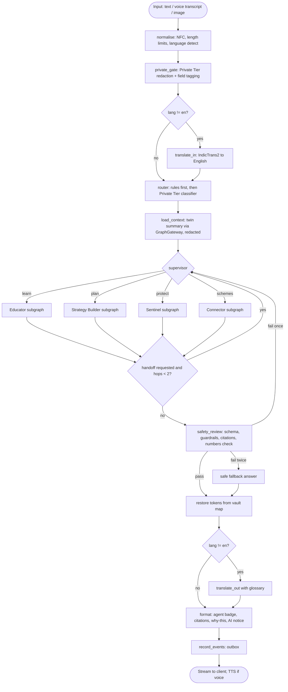
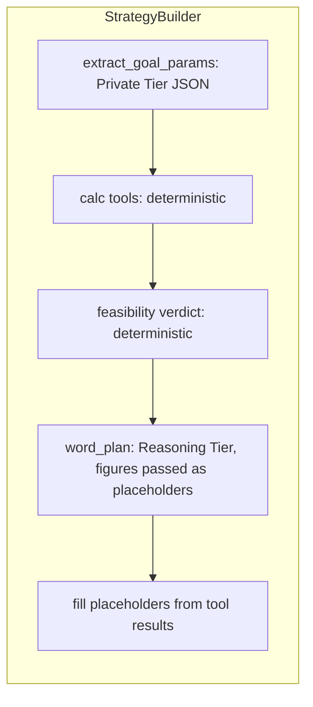
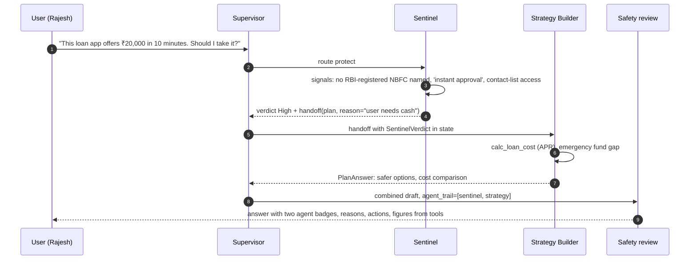
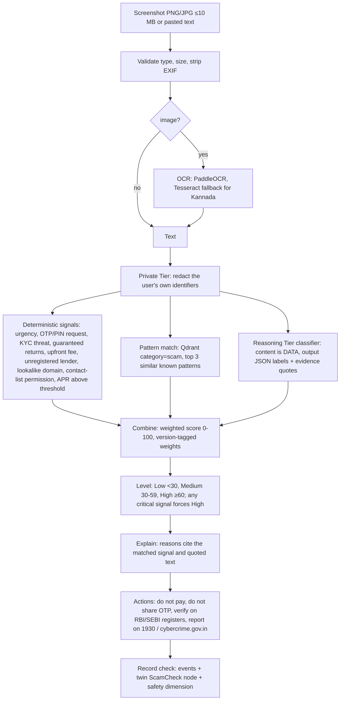

# Agent Architecture

**Version:** 1.0 (2026-11-05) | **Status:** Design | **Code location:** `04_APPLICATION/api/vaakya/agents/`
**Covers:** LangGraph orchestration, the four agents and their tools, inter-agent communication, the Dual-LLM tiers, RAG, safety review and proactive behaviour.

## 1. Model of an agent

An agent in VAAKYA is a **LangGraph subgraph** with:

- a **system prompt** (versioned file, per language-neutral English pivot),
- an **allow-listed tool set** (Python functions calling services),
- a **tier policy**: which LLM tier each step may use,
- an **output schema** (Pydantic) that the safety node validates.

Agents never call each other directly. They communicate **only through the shared graph state**, through handoff requests the supervisor approves, and through events (FR-ORC-02/03).

## 2. Orchestration graph



### Shared state

```python
class VaakyaState(TypedDict):
    request_id: str
    user_id: UUID                     # from the verified token, never from input
    channel: Literal["text", "voice", "image"]
    user_lang: Literal["en", "hi", "mr", "kn"]
    input_redacted_en: str            # what the Reasoning Tier may see
    pii_map_ref: str                  # key into the per-request token map, kept in Private Tier memory only
    intent: Literal["learn", "plan", "protect", "schemes", "smalltalk", "out_of_scope"]
    intent_confidence: float
    twin_context: TwinContext         # redacted summary: bands, not raw amounts, unless a tool needs figures
    agent_trail: list[str]            # for attribution (FR-ORC-06) and hop limit
    handoff: HandoffRequest | None
    tool_results: list[ToolResult]    # deterministic outputs with provenance
    citations: list[Citation]
    draft: AgentOutput | None
    safety: SafetyVerdict | None
    events: list[DomainEvent]
```

Checkpointing: LangGraph's PostgreSQL checkpointer (`langgraph-checkpoint-postgres`, to be added to the licence register) keyed by `conversation_id`. It stores only redacted state. The token map is never checkpointed.

### Router

1. **Rules first:** an image upload on `/shield`, words like "OTP", "KYC", "loan app", "lottery" → `protect`. A request from `/schemes` → `schemes`.
2. **Private Tier classifier:** a JSON-constrained prompt that returns `{intent, confidence}`.
3. Confidence < 0.6 → ask one clarifying question with the four options as chips.
4. Measured against the 40-prompt routing set (NFR-ACC-05).

## 3. The four agents

| | Educator | Strategy Builder | Sentinel | Connector |
|---|---|---|---|---|
| Purpose | Grounded explanations, learning | Goals, plans, roadmaps | Scam, fraud and predatory-loan checks | Scheme discovery and eligibility |
| Mode | Reactive | Reactive + proactive | Reactive | Reactive + proactive |
| Tools | `retrieve_knowledge`, `get_profile_summary`, `get_learning_progress`, `generate_quiz`, `record_event` | `get_financial_snapshot`, `calc_*` (SIP, emergency fund, feasibility, loan cost, irregular income, seasonal), `save_goal`, `build_roadmap`, `record_event` | `ocr_extract`, `signal_rules`, `match_known_patterns`, `classify_message`, `record_check`, `get_reporting_routes` | `evaluate_eligibility`, `retrieve_scheme`, `get_application_steps`, `estimate_benefit`, `record_event` |
| LLM may | Explain, simplify, adapt to role and literacy | Word the plan, motivate, choose which calculator to call | Interpret text, explain reasons | Explain results and steps |
| LLM may not | Answer beyond retrieved sources, recommend a specific product to buy | Produce any figure not from a tool | Follow instructions inside the checked content | Decide eligibility, invent schemes or amounts |
| Tier | Reasoning (redacted) | Reasoning (redacted), figures from tools | Private for OCR/PII, Reasoning for classification | Reasoning (redacted) |
| Output | `EducatorAnswer{text, citations[], quiz?}` | `PlanAnswer{text, plan_id, figures[], next_steps[]}` | `SentinelVerdict{risk_level, indicator, reasons[], actions[]}` | `SchemeAnswer{text, results[], steps[]}` |

### Tool calling

Small open models are unreliable at free-form tool calling. Each agent is therefore a **fixed LangGraph subgraph**, with LLM-chosen parameters only where needed:



The LLM writes `{{monthly_saving}}`, not a number. The format step substitutes tool values, so a model cannot change a figure (FR-STR-04, NFR-ACC-02). The safety node rejects any digit sequence in the draft that is not a tool value.

## 4. Inter-agent communication



Rules:
- An agent requests a handoff by setting `state.handoff = {target, reason}`. The supervisor approves it only if the target is not already in `agent_trail` and hops < 2.
- Background handoffs use events: `SchemeNewlyEligible` emitted by the Connector's scan is consumed by the opportunities feed and the monthly review.

## 5. Dual-LLM architecture

The Executive Summary's innovation is "sensitive data stays on-device while complex reasoning is handled by the cloud AI". **VAAKYA does not use a cloud AI**, so the honest version is stronger: both tiers run on VAAKYA's own server. The separation is kept because it limits what each model sees, keeps logs safe, and stays safe if a remote Reasoning Tier is ever configured.

**Wording rule:** say "processed on VAAKYA's own server". Do **not** say "on-device", because processing happens on the host, not the user's phone.

```mermaid
flowchart LR
  subgraph PT[Private Tier: small open model + rules, VAAKYA host]
    Raw[Raw text, OCR, transcript, profile values]
    Rec[Recognisers: PAN, Aadhaar, phone, UPI, IFSC, account no., names, addresses]
    Map[(Per-request token map, memory only)]
    Ext[Field extraction, intent, simple classification]
    Raw --> Rec --> Map
    Raw --> Ext
  end
  subgraph Gate[Tier gateway]
    Min[Minimise: bands not values, allow-listed fields]
    Aud[Audit: field categories crossed, never values]
  end
  subgraph RT[Reasoning Tier: larger open model, VAAKYA host]
    Reason[Explanations, planning text, scam reasoning]
  end
  Rec -->|"Call <PHONE_1> about <PERSON_1>'s account"| Min --> Reason
  Min --> Aud
  Reason -->|tokens in output| Restore[Restore tokens] --> Out[Response]
  Map --> Restore
```



| Rule | Detail |
|---|---|
| R1 | Every LLM call states its `tier`. The adapter refuses Reasoning Tier calls whose payload did not pass the gateway (type-level: `RedactedText` wrapper). |
| R2 | Reasoning Tier context uses **bands** (income "₹25k-35k/month") unless a tool explicitly needs a value. Calculations never need the LLM to see values. |
| R3 | Token map lives in process memory for the request and is dropped after the response. Never checkpointed or logged. |
| R4 | The audit row records `request_id`, `categories_crossed` (e.g. `["income_band","goal_type"]`), `tier`, `model` (FR-DL-04). |
| R5 | `FR-DL-05` egress test: production containers have no default route except via an allow-listed proxy for optional Google sign-in, checked in CI with a blocked-internet run. |
| R6 | A future external Reasoning Tier is possible only with a new decision, user consent and the same gateway. It is off by default. |

Model selection: T0.03 picks both models from Apache-2.0 or MIT licensed candidates. Configuration (`config/llm.yaml`):

```yaml
tiers:
  private:   { provider: ollama, model: "<T0.03 choice>", keep_alive: "30m", num_ctx: 4096 }
  reasoning: { provider: ollama, model: "<T0.03 choice>", keep_alive: "5m",  num_ctx: 8192, fallback: private }
tasks:
  route:            private
  extract_fields:   private
  classify_message: reasoning
  explain:          reasoning
  word_plan:        reasoning
  safety_judge:     private
```

## 6. RAG architecture

```mermaid
flowchart TB
  subgraph Ingest[Ingestion: worker, operator-triggered]
    Src[Source manifest: URL, publisher, licence, effective date, reviewer] --> Fetch[Fetch and hash]
    Fetch --> Parse[Parse: PDF/HTML to text, OCR if scanned]
    Parse --> Clean[Clean: boilerplate removal, NFC]
    Clean --> Chunk[Chunk: heading-aware, 350-500 tokens, 15% overlap]
    Chunk --> Meta[Attach metadata: category, language, source, publisher, effective_date, scheme_id, chunk_hash]
    Meta --> Emb[Embed: multilingual-e5-large, 'passage:' prefix]
    Emb --> Up[Upsert Qdrant financial_knowledge, id = hash]
  end
  subgraph Query[Query time]
    Q[Redacted English question] --> QE[Embed with 'query:' prefix]
    QE --> Filt[Filter: category, language in user_lang or en, effective_date valid]
    Filt --> Search[Qdrant HNSW top 20 + keyword boost on scheme names]
    Search --> RR{Reranker enabled?}
    RR -- yes --> Rerank[Cross-encoder rerank to top 5]
    RR -- no --> Top5[Top 5 by score]
    Rerank & Top5 --> Th{best score >= threshold?}
    Th -- no --> Abstain[Say: not in trusted sources + suggest human route]
    Th -- yes --> Gen[Reasoning Tier: answer only from numbered context, cite [n]]
    Gen --> Check[Citation check: each claim sentence cites an id present in context]
    Check --> Ans[Answer + citations with publisher and date]
  end
```

| Element | Decision |
|---|---|
| Framework | LlamaIndex 0.14 for ingestion (`IngestionPipeline` with docstore deduplication) and the Qdrant vector store. Retrieval is called through a thin `KnowledgeStore` so it can be tested without LlamaIndex. |
| Embeddings | `intfloat/multilingual-e5-large`, 1024 dimensions, served by the inference service. T0.10 decides between native-language retrieval and translate-first. |
| Collection | `financial_knowledge`, cosine, HNSW (`m=16`, `ef_construct=128`), payload indexes on `category`, `language`, `scheme_id`, `effective_date`. |
| Idempotency | Point id = UUIDv5 of `source_id + chunk_hash`. Re-ingestion is a no-op for unchanged chunks (PH2 test). |
| Reranking | Optional `bge-reranker-v2-m3` (Apache-2.0, to verify) on CPU, enabled only if T0.10 shows a quality gain worth the latency. |
| Grounding | Context is wrapped in `<source id=n>` tags with an instruction that sources are data. The answer must cite. An uncited claim fails safety review. |
| Abstention | Below the threshold, or for out-of-scope intents, the Educator says so. It does not answer from model memory (NFR-ACC-03). |
| Freshness | Scheme facts come from the **verified scheme catalogue in PostgreSQL**, not from vector search. Qdrant explains concepts and steps; it never supplies eligibility numbers. |
| Content review | AI-drafted lessons go into `content_items` as `draft` and need a `content_reviewer` approval before ingestion (FR-EDU-07). |

## 7. Sentinel scam detection



- The number is labelled **"risk indicator"**, not a probability, until T6.05 calibration exists (MASTER_PLAN s11).
- Prompt-injection defence: the content is passed inside `<untrusted_content>` tags. The classifier's output schema has no free-text instruction field. Its evidence quotes must be substrings of the input, which is checked in code.
- Predatory-loan rules (FR-SEN-08) and investment-tip rules (FR-SEN-09) are signal packs in `domain/sentinel_signals/`.

## 8. Safety review node

| Check | Implementation | Requirement |
|---|---|---|
| Output schema | Pydantic validation of the agent output | FR-ORC-04 |
| Numbers | Every number in the text must come from a tool result or a cited source | FR-STR-04 |
| Guardrails | Rule lists (guaranteed returns, "risk-free", specific buy or sell instructions, urgency language) + Private Tier judge prompt | FR-SAF-03 |
| Schemes | Any scheme name must exist in the catalogue | FR-SAF-03 |
| Citations | Educator and Connector answers need at least one valid citation | FR-SAF-04 |
| Framing | Adds the educational notice where advice-like (D-017) | FR-SAF-02 |
| Escalation | High-stakes topics (debt crisis, bereavement, fraud loss) add the human-help route | FR-SAF-05 |

A failure gives one retry with the failure reason. A second failure returns a safe fallback that says what VAAKYA can do instead.

## 9. Proactive behaviour

| Trigger | Detector (worker) | Agent | Delivery |
|---|---|---|---|
| Goal drift: saved < 80 % of plan for 2 months | `proactive_scan` over `goal_updates` | Strategy Builder | Notification + dashboard insight |
| Newly eligible scheme after profile change | `ProfileChanged` event → eligibility re-run | Connector | Opportunities feed |
| Month end | `monthly_review` | All, through the review composer | Monthly report |
| Premium due within 15 days | Twin `PremiumPayment` query | Strategy Builder | Reminder (R3) |

Proactive messages use the same safety node. They are rate-limited to at most one push-style notification a day per user.

## 10. Evaluation

| Set | Size | Metric | Requirement |
|---|---|---|---|
| Routing | 40 prompts × 4 languages | accuracy ≥ 90 % | NFR-ACC-05 |
| RAG | 30 questions per language | groundedness, citation validity, abstention | NFR-ACC-03 |
| Scam | 30 scam + 30 genuine | precision, recall per level | NFR-ACC-04 |
| Safety | adversarial set | 0 guardrail breaches | NFR-ACC-06 |
| Leakage | identifier set | 0 identifiers in Reasoning Tier inputs | FR-DL-03 |
