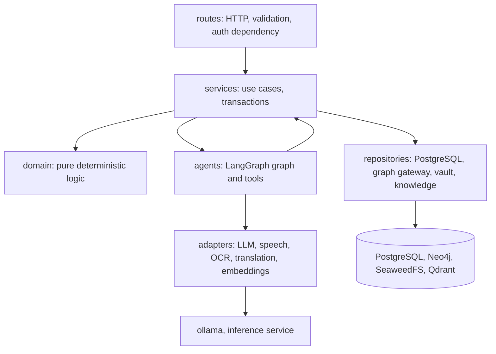

# Backend Architecture

**Version:** 1.0 (2026-11-05) | **Status:** Design | **Location when built:** `04_APPLICATION/api/` and `04_APPLICATION/inference/`
**Stack:** Python 3.13, FastAPI 0.162, Pydantic 2.14, SQLAlchemy 2.1 + Alembic, psycopg 3, neo4j driver 6, qdrant-client 1.20, LangGraph 1.2, LlamaIndex 0.14, APScheduler 3.11, structlog, OpenTelemetry. Lockfile proven in T0.06.

## 1. Style

A **modular monolith** with clear layers. One deployable `api` image, also run as `worker` with a different command. GPU engines sit in a separate `inference` service, so the API image stays CPU-only.



**Import rules** (checked by `import-linter` in CI):
`routes → services → (domain, repositories, agents, adapters)`. `domain` imports nothing from the project except `domain`. `agents` call services through tool functions and never call repositories directly. Nothing imports `routes`.

## 2. Package layout

```text
api/
  vaakya/
    main.py                  # app factory, middleware, routers
    config.py                # pydantic-settings
    core/                    # errors, logging, tracing, ids, money (Decimal paise), clock
    auth/                    # JWT verification, CurrentUser dependency, roles
    routes/                  # one module per resource (see API_DESIGN.md)
      me.py onboarding.py documents.py assessment.py dashboard.py goals.py chat.py voice.py
      sentinel.py schemes.py score.py twin.py learning.py reviews.py opportunities.py admin.py health.py
    schemas/                 # Pydantic request and response models, shared with OpenAPI
    services/                # use cases
      profile.py consent.py documents.py extraction.py assessment.py goals.py planning.py
      sentinel.py eligibility.py score.py learning.py reviews.py opportunities.py data_rights.py
      notifications.py events.py
    domain/                  # deterministic, fully unit-tested, no I/O
      calculators/           # sip, emergency_fund, loan_cost (APR), goal_feasibility, irregular_income, seasonal
      eligibility/           # rule DSL evaluator + per-scheme rule files
      score/                 # FCS formula v1, versioned
      sentinel_signals/      # regex and heuristic signals, weights
      redaction/             # Indian identifier recognisers (PAN, Aadhaar, IFSC, UPI, phone, account)
    repositories/
      pg/                    # SQLAlchemy models and queries
      graph/                 # GraphGateway: the only Neo4j access (FR-FLG-09)
      vault/                 # DocumentVault over S3 API (SeaweedFS)
      knowledge/             # KnowledgeStore over Qdrant
    agents/                  # LangGraph state, nodes, agents, tools, prompts (AGENT_ARCHITECTURE.md)
    adapters/
      llm.py                 # LLMAdapter protocol, OllamaProvider, tier routing, fallback
      speech.py              # SpeechAdapter: per-language STT/TTS engine config
      translate.py ocr.py embed.py
      queue.py               # GPU priority queue
    jobs/                    # APScheduler jobs and the outbox relay
  migrations/                # Alembic
  tests/ unit/ contract/ integration/ eval/
inference/
  app.py                     # FastAPI: /stt /tts /translate /ocr /embed /health
  engines/                   # faster_whisper.py parler_tts.py espeak.py indictrans2.py paddle.py tesseract.py e5.py
```

## 3. API modules

| Module | Routes prefix | Services | Requirements |
|---|---|---|---|
| Identity and profile | `/v1/me` | profile, consent, data_rights | FR-ONB-03/04, FR-SAF-06 |
| Onboarding | `/v1/onboarding` | profile, assessment | FR-ONB-05/06 |
| Documents | `/v1/documents` | documents, extraction | FR-DOC-* |
| Assessment | `/v1/assessment` | assessment, score | FR-ASM-* |
| Dashboard | `/v1/dashboard` | aggregates of score, goals, learning, schemes, sentinel | FR-DSH-01/02 |
| Goals | `/v1/goals` | goals, planning | FR-STR-* |
| Chat | `/v1/chat`, `/v1/conversations` | orchestrator | FR-ASK-*, FR-ORC-* |
| Voice | `/v1/voice` | orchestrator + speech | FR-VOI-* |
| Sentinel | `/v1/sentinel` | sentinel | FR-SEN-* |
| Schemes | `/v1/schemes` | eligibility | FR-CON-* |
| Score | `/v1/score` | score | FR-FCS-* |
| Twin | `/v1/twin` | graph read model | FR-FLG-10 |
| Learning | `/v1/learning` | learning | FR-EDU-04/05/08 |
| Reviews | `/v1/reviews` | reviews | FR-COA-* |
| Opportunities | `/v1/opportunities` | opportunities | FR-CON-10 |
| Admin | `/v1/admin` | content review, scheme data, evaluation runs | FR-EDU-07, FR-CON-12 |
| Health | `/healthz`, `/readyz`, `/metrics` | - | NFR-OBS-02 |

## 4. Middleware stack (outermost first)

| # | Middleware | Behaviour |
|---|---|---|
| 1 | Request ID | Accept a valid `X-Request-ID` or create a UUIDv7. Bind it to logs and the trace. Return it in the response. |
| 2 | OpenTelemetry | Span per request, propagated to Ollama, inference and database calls (NFR-OBS-01). |
| 3 | Access log | One structured line: method, route template, status, duration, user hash. No bodies. |
| 4 | Body size limit | 1 MB JSON, 10 MB multipart (FR-SEN-01), 5 MB audio. Exceeding returns 413. |
| 5 | CORS | Same-origin only. The BFF is the only browser caller. |
| 6 | Rate limit | Token bucket per user and per IP, held in PostgreSQL or memory. Separate buckets for LLM, upload and voice routes (NFR-SEC-09, NFR-COST-02). |
| 7 | Error handler | Converts exceptions to RFC 9457 problem details. Never leaks stack traces. |

Authentication is a **FastAPI dependency**, not middleware, so every route declares it and an untested route without it fails the CI route audit.

## 5. Authentication verification

```python
async def current_user(token = Depends(bearer)) -> CurrentUser:
    claims = jwt.decode(token, key=jwks.get_signing_key(kid), algorithms=["RS256"],
                        audience="vaakya-api", issuer=settings.oidc_issuer,
                        options={"require": ["exp", "iat", "sub", "aud", "iss"]}, leeway=30)
    return CurrentUser(id=uuid_from_sub(claims["sub"]), roles=claims["realm_access"]["roles"])
```

- JWKS fetched from Keycloak and cached with `kid` rotation handling (PyJWT `PyJWKClient`).
- `algorithms` fixed to RS256. `none` and HS* are rejected.
- Roles: `user`, `content_reviewer`, `operator`. Admin routes need `operator` or `content_reviewer`.
- First request after registration provisions a `users` row (just-in-time), keyed by `sub`.
- `/healthz`, `/readyz` are unauthenticated. `/metrics` is only on the internal network.

## 6. Validation

- **Pydantic v2 models** for every body, query and path parameter, with `extra="forbid"`.
- Constrained types: `Rupees` (non-negative int paise, upper bound), `Percent`, `LanguageCode = Literal["en","hi","mr","kn"]`, `MonthKey` (`YYYY-MM`).
- Domain validation in services (goal date in the future, dependents ≥ 0) raises `DomainValidationError` → 422.
- Free text is length-limited (chat 2,000 characters, pasted scam text 5,000) and Unicode NFC-normalised.
- Uploads validated by magic bytes, not by extension (see SECURITY_ARCHITECTURE.md).

## 7. Error handling

| Exception | HTTP | `type` URI suffix | User message |
|---|---|---|---|
| `AuthError` | 401 | `unauthenticated` | Please sign in again |
| `ForbiddenError` | 403 | `forbidden` | You do not have access |
| `NotFoundError` (including other users' ids) | 404 | `not-found` | Not found |
| `RequestValidationError`, `DomainValidationError` | 422 | `validation` | Field-level errors |
| `ConsentRequiredError` | 409 | `consent-required` | Consent needed for this action |
| `RateLimited` | 429 | `rate-limited` | Try again in N seconds, with `Retry-After` |
| `InferenceUnavailable`, `QueueTimeout` | 503 | `ai-unavailable` | Safe fallback text, never a fabricated answer (FR-ORC-04) |
| Unhandled | 500 | `internal` | Generic message + `request_id` |

Other users' resources return **404, not 403**, so ids cannot be probed.

Problem details body:

```json
{ "type": "https://vaakya.app/problems/validation", "title": "Invalid request", "status": 422,
  "detail": "target_amount must be greater than 0", "instance": "/v1/goals",
  "request_id": "0193...", "errors": [{"loc": ["body","target_amount"], "msg": "must be > 0"}] }
```

## 8. Logging

- **structlog** JSON to stdout, collected by Loki through the OTel collector.
- Fields: `ts`, `level`, `event`, `request_id`, `trace_id`, `route`, `user` (HMAC of the user id with a server key), `agent`, `tier`, `model`, `latency_ms`, `tokens_in/out`.
- **Never logged:** request or response bodies, prompts, OCR text, transcripts, document contents, amounts, names, identifiers (NFR-SEC-07). A structlog processor drops unknown keys and runs the redaction recognisers over string values as a backstop.
- Prompts and outputs for debugging are captured **only** in development, behind `VAAKYA_DEBUG_PROMPTS=1`, refused at startup when `ENV=production`.

## 9. Services that matter most

| Service | Key behaviour |
|---|---|
| `extraction` | Job: vault → OCR → Private Tier field extraction (JSON schema-constrained) → rule validation → `pending_review`. Values reach the twin only after user confirmation (FR-DOC-05). |
| `planning` | Calls `domain.calculators`. Produces a `Plan` with every figure and its inputs, used by "Why this" (FR-ASK-02). |
| `eligibility` | Evaluates rule files per scheme. Returns per-criterion `met`, `not_met` or `unknown`, with the missing field. |
| `score` | Pure function of events since the last snapshot. Writes `score_history` with `formula_version` and reason. |
| `sentinel` | Signals → pattern match → Reasoning Tier classification → combine into a risk indicator. Records the check. |
| `events` | Appends to `events` and `outbox` in one transaction. The relay applies twin updates and Confidence Engine recalculation. |
| `data_rights` | Export (ZIP of JSON + original files) and delete across all four stores, with a verification step. |

## 10. Background jobs (worker)

| Job | Schedule | Purpose |
|---|---|---|
| `outbox_relay` | Every 5 s | Apply graph projections and score recalculations |
| `extract_document` | On demand | OCR and extraction off the request path |
| `monthly_review` | 1st of month, 06:00 IST | Generate reviews (FR-COA-01) |
| `proactive_scan` | Daily | Goal drift, newly eligible schemes, premium reminders (FR-STR-11, FR-CON-11) |
| `scheme_freshness` | Daily | Flag schemes past their review date (FR-CON-12) |
| `retention_purge` | Daily | Delete expired voice, documents and soft-deleted users (NFR-PRIV-02) |
| `graph_reconcile` | Weekly | Compare PostgreSQL and Neo4j counts, rebuild drift |

APScheduler stores jobs in PostgreSQL. Only one worker runs, holding a PostgreSQL advisory lock.

## 11. Inference service contract

| Endpoint | Input | Output |
|---|---|---|
| `POST /stt` | audio (webm/opus or wav, ≤ 60 s), `lang` hint | `{text, lang, confidence, segments}` |
| `POST /tts` | `{text, lang, voice}` | `audio/ogg` |
| `POST /translate` | `{text, src, tgt, glossary_id}` | `{text}` |
| `POST /ocr` | image or PDF page, `script_hint` | `{lines:[{text, bbox, conf}], engine}` |
| `POST /embed` | `{texts[], kind: "query"|"passage"}` | `{vectors[][1024]}` (e5 prefixes added server-side) |

Internal network only, mutual shared-secret header, no user identifiers in payloads beyond the content itself.

## 12. Testing

| Level | Target |
|---|---|
| Unit | `domain/` at ≥ 95 % branch coverage. Table tests for every calculator and eligibility rule |
| Contract | `LLMAdapter`, `SpeechAdapter` with recorded fixtures |
| Integration | Testcontainers or Compose: PostgreSQL, Neo4j, Qdrant, SeaweedFS, Keycloak (pattern proven by `service_probe.py` in T0.06) |
| Security | Cross-user test per resource, route-auth audit, upload fuzz |
| Agent eval | `tests/eval/` labelled sets, run nightly, results in `05_TESTING/` |
