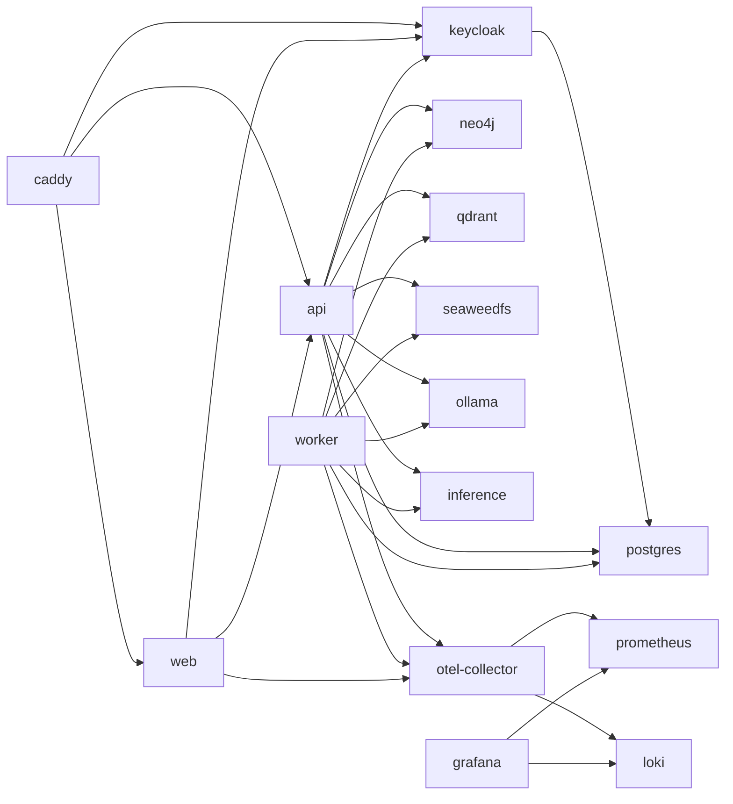
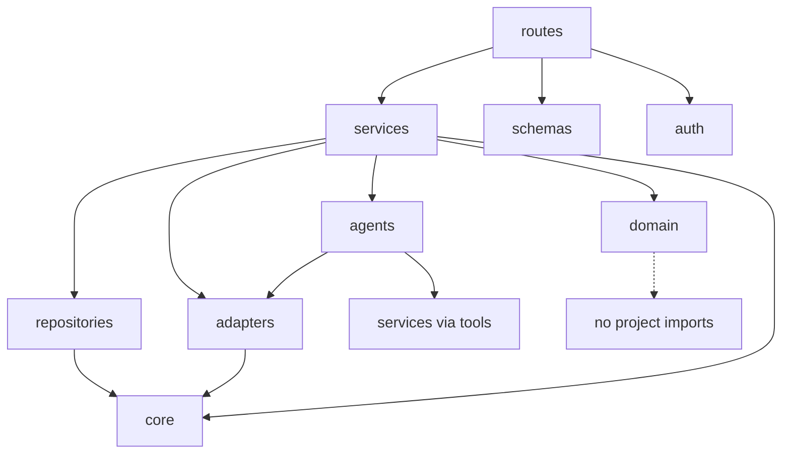
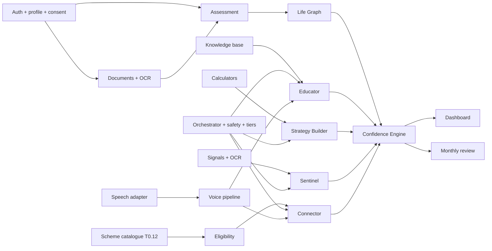

# Component Dependencies

**Version:** 1.0 (2026-11-05) | **Status:** Design
**Licences:** `06_DOCUMENTATION/LICENCE_REGISTER.md` is the source of truth. **Versions:** the T0.06 lockfiles in `02_ARCHITECTURE/evaluations/T0.06_stack/` are the source of truth until T1.01 moves them into `04_APPLICATION/`.

## 1. Version validation

### Baseline from the Executive Summary (checked 2026-11-05)

| Baseline | Available? | Usable? | Evidence |
|---|---|---|---|
| Next.js 14.2.30 | Yes | **No.** Deprecated on npm for a security vulnerability | `05_TESTING/evaluations/ARCH_BASELINE/baseline_version_check.txt` |
| TypeScript 5.5.4, Tailwind 3.4.4 | Yes | Superseded | npm registry |
| Python 3.12.4, FastAPI 0.111.1 | Yes | Superseded; FastAPI 0.111 is 50+ minor releases behind | PyPI |
| LangGraph 0.2.x | Yes (last 0.2.76) | Superseded by 1.x | PyPI |
| Qdrant 1.10.1, LlamaIndex 0.11.7 | Yes | Superseded | PyPI |
| Coqui TTS 0.22 | Yes (last release, Dec 2023) | **No.** Needs Python <3.12, and conflicts with LlamaIndex 0.11.7 over networkx. XTTS weights are non-commercial | Resolver output in evidence file |
| IndicTrans2 1.1 | **No versioned release exists** | Pin a commit | DECISIONS_LOG §5 |
| PaddleOCR 2.7.3 | Yes | Superseded by 3.x | PyPI |
| Gemini 2.5 Pro, Firestore, Firebase Auth/Storage, AWS | Proprietary services | **Rejected (D-026)** | - |

### Adopted set (T0.06, verified by build and tests)

| Layer | Component | Version |
|---|---|---|
| Web | Next.js / React / TypeScript / Tailwind | 16.4.5 / 19.3.1 / 7.0.2 / 4.3.4 |
| Runtime | Node | 22.14+ (tested 22.14.0 and 22.23.4) |
| API | Python / FastAPI / Pydantic / uvicorn | 3.13 (3.12 tested) / 0.162.0 / 2.14.3 / 0.54.0 |
| Agents | LangGraph / LlamaIndex core / qdrant vector store | 1.2.20 / 0.14.25 / 0.10.4 |
| Data clients | psycopg / SQLAlchemy / Alembic / neo4j / qdrant-client / boto3 | 3.3.8 / 2.1.8 / 1.20.1 / 6.4.1 / 1.20.0 / 1.43.124 |
| Platform | APScheduler / Presidio / PyJWT / structlog / OTel SDK / prometheus-client / ollama client | 3.11.3 / 2.2.366 / 2.15.1 / 26.1.0 / 1.45.2 / 0.26.0 / 0.6.3 |
| Services | PostgreSQL / Neo4j / Qdrant / SeaweedFS / Keycloak / Caddy | 18.6 / 5.26.32 / 1.20.0 / 4.50 / 26.8.1 / 2.11.8 |

### Still to select or verify

| Component | Decided by | Notes |
|---|---|---|
| Private and Reasoning Tier models, Ollama version | T0.03 | Apache-2.0 or MIT weights only |
| faster-whisper + model size | T0.08 | GPU vs CPU |
| TTS engine per language | T0.07 | Indic Parler-TTS licence must be verified |
| IndicTrans2 commit, glossary | T0.09 | |
| e5 retrieval mode, optional reranker | T0.10 | |
| PaddleOCR 3.x vs Tesseract per script | T0.13 | |
| spaCy model for Presidio | T0.04 | |
| `langgraph-checkpoint-postgres`, `next-intl`, TanStack Query, React Hook Form, Zod, `openapi-typescript`, `age`, ClamAV | T1.x | Add to licence register before use |

## 2. Runtime service dependencies

| Service | Hard dependencies (fails readiness without) | Soft dependencies (degrades) |
|---|---|---|
| web | api, keycloak | - |
| api | postgres, keycloak JWKS | neo4j (answers without twin context), qdrant (Educator abstains), ollama (deterministic results only + safe message), inference (text-only, no OCR), seaweedfs (uploads disabled) |
| worker | postgres | others, with job retry and backoff |
| keycloak | postgres | Google IdP |

Start order in Compose uses `depends_on: condition: service_healthy` for hard dependencies only.

## 3. Internal module dependencies (api)

Enforced by `import-linter` contracts:

1. `vaakya.domain` must not import any other `vaakya` package.
2. `vaakya.routes` may not import `repositories`, `adapters` or `agents` directly.
3. Only `vaakya.repositories.graph` may import `neo4j`. Only `vaakya.repositories.vault` may import `boto3`. Only `vaakya.adapters.llm` may import `ollama` or `httpx` for model calls.
4. `vaakya.agents` may not import `vaakya.repositories`.

## 4. Feature dependency chain

This matches the phase order in `IMPLEMENTATION_ROADMAP.md`: PH1 auth, PH2 data and knowledge, PH3 orchestrator, PH4 onboarding and twin, PH5 to PH7 agents, PH8 engine and dashboard.

## 5. External dependencies

| Dependency | Runtime? | Needed for | Without it |
|---|---|---|---|
| Google identity provider | Optional | Google sign-in | Email login works |
| Let's Encrypt | Renewal only | TLS certificates | Manual certificates |
| Official source sites (RBI, SEBI, scheme portals) | No, build-time only | Corpus and catalogue refresh | Existing data, flagged stale after review date |
| Model hubs (Ollama library, Hugging Face) | No, build-time only | Fetch weights once | Stored weights on host |
| GitHub, Docker Hub | No | Code and image distribution | Local builds |
