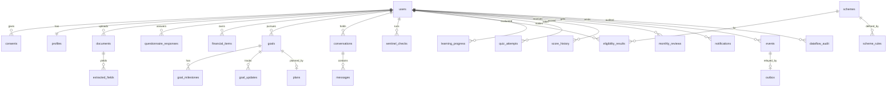
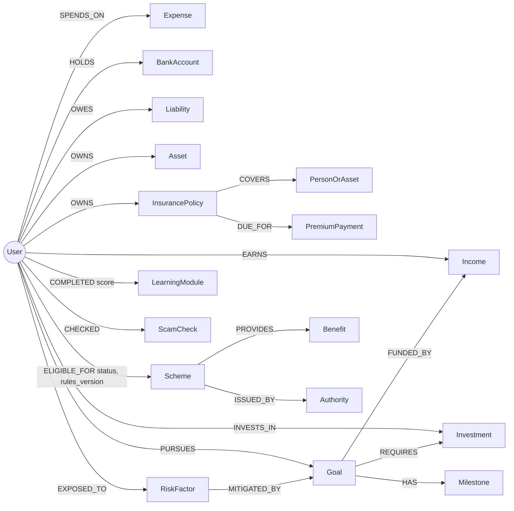

# Database Architecture

**Version:** 1.0 (2026-11-05) | **Status:** Design | **Decisions:** D-010 (ownership), D-024 (SeaweedFS), D-027 (PostgreSQL)

## 1. Stores and ownership

| Store | Version (T0.06) | Role | Holds personal data | System of record |
|---|---|---|---|---|
| PostgreSQL | 18.6 | Application data, events, audit, scheme catalogue, scheduler jobs, Keycloak's database (separate DB) | Yes | **Yes** |
| Neo4j Community | 5.26 | Financial Life Graph: a per-user relationship projection | Yes, minimal | No: rebuilt from PostgreSQL |
| Qdrant | 1.20.0 | Public knowledge vectors | **No** | No: rebuilt from the corpus manifest |
| SeaweedFS | 4.50 | Encrypted raw documents, screenshots, temporary audio | Yes | Yes, for file bytes |

**Rule (D-010):** every write goes to PostgreSQL first, in one transaction with an `outbox` row. The worker projects outbox rows into Neo4j. Losing Neo4j or Qdrant loses no data.

## 2. PostgreSQL schema

Conventions: `uuid` primary keys (UUIDv7), `created_at`/`updated_at timestamptz`, money as `bigint` paise, `user_id` on every user-owned row with a foreign key and an index. Row Level Security (RLS) is enabled on user tables as a second line of defence: the API sets `SET LOCAL vaakya.user_id = …` per transaction.



### Core tables

| Table | Key columns | Notes |
|---|---|---|
| `users` | `id`, `keycloak_sub` (unique), `status` (`active`, `deletion_pending`, `deleted`), `deleted_at` | No name or email here: Keycloak holds credentials |
| `profiles` | `user_id` PK, `display_name`, `age_band`, `birth_year`, `occupation`, `state`, `district`, `rural` bool, `preferred_lang`, `income_type` (`salaried`, `variable`, `seasonal`), `literacy_level`, `disability` jsonb, `dependents` | FR-ONB-03/06 |
| `preferences` | `user_id` PK, `text_scale`, `contrast`, `reduced_motion`, `voice_first`, `low_literacy` | FR-A11-01 |
| `consents` | `id`, `user_id`, `purpose` (`document_storage`, `ai_processing`, `voice_processing`, `email`), `version`, `granted_at`, `withdrawn_at` | Append-only (FR-ONB-04) |
| `documents` | `id`, `user_id`, `kind`, `object_key`, `sha256`, `mime`, `size`, `status` (`uploaded`, `ocr_done`, `pending_review`, `confirmed`, `rejected`), `retain_until` | FR-DOC-01/02 |
| `extracted_fields` | `id`, `document_id`, `field`, `value_json`, `confidence`, `confirmed_value_json`, `confirmed_at` | FR-DOC-04/05 |
| `questionnaire_responses` | `user_id`, `question_id`, `answer_json`, `source` (`typed`, `voice`, `document`) | FR-ASM-* |
| `financial_items` | `id`, `user_id`, `type` (`income`, `expense`, `asset`, `liability`, `insurance`, `investment`, `bank_account`), `attributes` jsonb, `amount_paise`, `frequency`, `source_ref` | Canonical facts for the twin |
| `goals` | `id`, `user_id`, `type`, `title`, `target_paise`, `target_date`, `priority`, `status` | FR-STR-01 |
| `plans` | `id`, `goal_id`, `calc_version`, `inputs` jsonb, `outputs` jsonb, `feasibility`, `created_at` | "Why this" source (FR-ASK-02) |
| `goal_milestones`, `goal_updates` | target per month; actual contributions | FR-STR-08 |
| `conversations`, `messages` | `messages.content_redacted`, `agent`, `citations` jsonb | Only redacted text is stored (FR-ASK-03) |
| `sentinel_checks` | `id`, `user_id`, `input_kind`, `risk_indicator`, `risk_level`, `signals` jsonb, `weights_version`, `object_key` (nullable) | FR-SEN-04/11 |
| `schemes` | `id` (slug), `name` jsonb per language, `category`, `authority`, `benefits` jsonb, `source_url`, `last_verified_at`, `review_due_at`, `verified_by` | NFR-ACC-01, FR-CON-12 |
| `scheme_rules` | `scheme_id`, `version`, `rules` jsonb (DSL), `effective_from` | FR-CON-02 |
| `eligibility_results` | `user_id`, `scheme_id`, `rules_version`, `status`, `criteria` jsonb, `evaluated_at` | FR-CON-03 |
| `content_items` | `id`, `kind` (`lesson`, `quiz`, `scam_pattern`), `lang`, `body`, `status` (`draft`, `approved`, `retired`), `reviewed_by` | FR-EDU-07 |
| `learning_progress`, `quiz_attempts` | module completion; per-question correctness | FR-EDU-05/08 |
| `score_history` | `user_id`, `formula_version`, `overall`, `dimensions` jsonb, `reason`, `computed_at` | FR-FCS-03/06 |
| `monthly_reviews` | `user_id`, `month`, `content` jsonb, `generated_at` | FR-COA-01 |
| `notifications` | `user_id`, `kind`, `payload`, `read_at` | FR-STR-11 |
| `events` | `id`, `user_id`, `type`, `payload` jsonb, `occurred_at` | Behaviour event log (FR-IMP-01), append-only |
| `outbox` | `id`, `event_id`, `target` (`graph`, `score`), `processed_at`, `attempts` | Relay to Neo4j and score |
| `dataflow_audit` | `request_id`, `user_id`, `tier`, `model`, `categories` text[], `at` | FR-DL-04 |
| `apscheduler_jobs` | managed by APScheduler | D-021 |
| `langgraph_checkpoints` | managed by LangGraph | redacted state only |

### Event types (selection)

`ProfileUpdated`, `DocumentConfirmed`, `AssessmentCompleted`, `GoalCreated`, `GoalContribution`, `LessonCompleted`, `QuizAnswered`, `ScamChecked`, `SchemeViewed`, `SchemeApplicationStarted`, `SchemeNewlyEligible`, `ReviewOpened`. The Confidence Engine reads only these, so the score is reproducible from history.

### Retention

| Data | Default retention |
|---|---|
| Voice audio | Deleted after transcription (not stored) |
| Raw documents | Until the user deletes, or 12 months after last use |
| Scam screenshots | 30 days, unless the user keeps them in history |
| Redacted messages | 12 months |
| Events, score history | Life of the account |
| Deleted account | Hard-deleted within 30 days across all stores, with a verification report |

## 3. Financial Life Graph (Neo4j)

### Nodes

| Label | Key properties | Source |
|---|---|---|
| `User` | `id` | users |
| `Income` | `id`, `type`, `band`, `frequency`, `seasonality` | financial_items |
| `Expense` | `id`, `category`, `band` | financial_items |
| `BankAccount` | `id`, `kind` | financial_items (no account numbers) |
| `Asset` / `PersonOrAsset` | `id`, `kind` (land, gold, vehicle, dependant), `band` | financial_items, profile |
| `Liability` | `id`, `kind`, `apr_band`, `emi_band` | financial_items |
| `InsurancePolicy` | `id`, `kind`, `cover_band`, `renewal_month` | financial_items |
| `PremiumPayment` | `id`, `due_date` | derived |
| `Investment` | `id`, `kind` (SIP, PPF, FD, EPF) | financial_items |
| `Goal` | `id`, `type`, `status`, `on_track` | goals |
| `Milestone` | `id`, `month`, `met` | goal_milestones |
| `Scheme` | `id` (shared catalogue node) | schemes |
| `Benefit` | `id`, `kind` | schemes |
| `Authority` | `id`, `name` | schemes |
| `LearningModule` | `id` (shared) | content |
| `ScamCheck` | `id`, `level`, `at` | sentinel_checks |
| `RiskFactor` | `kind` (no_emergency_fund, high_apr_debt, uninsured_dependant, income_volatility) | analyse job |

Graph values use **bands**, not exact amounts, because the twin is passed to agents as context. Exact figures stay in PostgreSQL for calculators.

### Relationships



The chains `PURSUES/HAS/REQUIRES`, `OWNS/COVERS/DUE_FOR` and `ELIGIBLE_FOR/PROVIDES/ISSUED_BY` are from deck slide 13. The others are this design's additions (PH2 per MASTER_PLAN s13).

### Constraints and indexes

```cypher
CREATE CONSTRAINT user_id IF NOT EXISTS FOR (u:User) REQUIRE u.id IS UNIQUE;
CREATE CONSTRAINT goal_id IF NOT EXISTS FOR (g:Goal) REQUIRE g.id IS UNIQUE;
CREATE CONSTRAINT scheme_id IF NOT EXISTS FOR (s:Scheme) REQUIRE s.id IS UNIQUE;
// one constraint per label with an id
CREATE INDEX owner_idx IF NOT EXISTS FOR (n:Goal) ON (n.owner);
```

Every user-owned node stores `owner = user.id`. Shared nodes (`Scheme`, `Benefit`, `Authority`, `LearningModule`) have no owner.

### Graph gateway (FR-FLG-09)

Neo4j Community has no per-user access control, so isolation lives in code:

- `GraphGateway` is the only module importing the `neo4j` driver (lint rule).
- It exposes **named queries only**. Each one takes `user_id` as its first parameter and matches `(u:User {id: $user_id})` as its anchor. There is no method for raw Cypher.
- All values are parameters. No string formatting into Cypher.
- A test runs every named query for user A against a graph seeded with user B and asserts zero B nodes returned.

### Important queries

```cypher
// Q1 twin_context: summary passed to agents (FR-FLG-07)
MATCH (u:User {id: $user_id})
OPTIONAL MATCH (u)-[:EARNS]->(i:Income)
OPTIONAL MATCH (u)-[:PURSUES]->(g:Goal {status: 'active'})
OPTIONAL MATCH (u)-[:EXPOSED_TO]->(r:RiskFactor)
OPTIONAL MATCH (u)-[e:ELIGIBLE_FOR {status: 'eligible'}]->(s:Scheme)
RETURN collect(DISTINCT i{.type,.band,.seasonality}) AS income,
       collect(DISTINCT g{.id,.type,.on_track}) AS goals,
       collect(DISTINCT r.kind) AS risks,
       collect(DISTINCT s.id) AS eligible_schemes;

// Q2 protection gaps: dependants not covered by any policy (FR-FLG-06)
MATCH (u:User {id: $user_id})-[:OWNS]->(p:PersonOrAsset {kind: 'dependant'})
WHERE NOT EXISTS { MATCH (u)-[:OWNS]->(:InsurancePolicy)-[:COVERS]->(p) }
RETURN p.id;

// Q3 eligible but not yet reviewed schemes (opportunities, FR-CON-10)
MATCH (u:User {id: $user_id})-[e:ELIGIBLE_FOR {status: 'eligible'}]->(s:Scheme)
WHERE coalesce(e.reviewed, false) = false
RETURN s.id, e.rules_version;

// Q4 goals with no funding source (Strategy Builder)
MATCH (u:User {id: $user_id})-[:PURSUES]->(g:Goal {status: 'active'})
WHERE NOT (g)-[:FUNDED_BY]->(:Income)
RETURN g.id;

// Q5 premiums due within N days (reminders, FR-COA-05)
MATCH (u:User {id: $user_id})-[:OWNS]->(:InsurancePolicy)-[:DUE_FOR]->(pp:PremiumPayment)
WHERE pp.due_date <= date() + duration({days: $days})
RETURN pp.due_date;

// Q6 Life Graph screen (FR-FLG-10): bounded 2-hop neighbourhood
MATCH path = (u:User {id: $user_id})-[*1..2]->(n)
WHERE n.owner = $user_id OR n:Scheme OR n:Benefit OR n:LearningModule
RETURN path LIMIT 300;

// Q7 erase user (FR-SAF-06)
MATCH (n {owner: $user_id}) DETACH DELETE n;
MATCH (u:User {id: $user_id}) DETACH DELETE u;
```

### Lifecycle mapping

| Stage | Trigger | Writer |
|---|---|---|
| Create | `AssessmentCompleted`, `DocumentConfirmed` | outbox relay: full twin build |
| Enrich | Goal, learning, sentinel, scheme events | outbox relay: incremental MERGE |
| Analyze | Nightly `analyse_twin` job | writes `RiskFactor` nodes |
| Act and guide | Q1 at request time | agents |
| Evolve (R3) | Outcome events feed recommendation weights | job |

## 4. Qdrant

| Setting | Value |
|---|---|
| Collection | `financial_knowledge` |
| Vector | 1024, cosine, HNSW `m=16`, `ef_construct=128` |
| Payload | `category` (`lesson`, `concept`, `scheme_info`, `scam_pattern`, `insurance_rule`, `faq`, `regulation`), `language`, `source_id`, `publisher`, `effective_date`, `scheme_id`, `chunk_hash`, `title`, `url` |
| Payload indexes | `category`, `language`, `scheme_id` (keyword), `effective_date` (datetime) |
| Personal data | None. User queries are never stored in Qdrant. |
| Snapshots | Nightly snapshot to SeaweedFS backup bucket |

## 5. SeaweedFS document vault

| Item | Decision |
|---|---|
| Access | S3 API through `DocumentVault` (boto3). Only the API and worker hold credentials. Browsers never get direct or presigned URLs in R1. |
| Buckets | `vaakya-user-docs` (documents, screenshots), `vaakya-backups` |
| Object key | `{userId}/{yyyy}/{mm}/{documentId}` (deck s14), no file name or PII in the key |
| Encryption | Application-level envelope encryption: AES-256-GCM data key per object, wrapped by a master key from Docker secrets. Plus an encrypted host volume (LUKS). |
| Integrity | SHA-256 stored in PostgreSQL and checked on read |
| Deletion | Delete object + mark row. A daily job checks that no object exists without a live row. |

## 6. Backups

| Store | Method | Frequency | Restore test |
|---|---|---|---|
| PostgreSQL | `pg_dump` custom format + WAL archiving | Nightly + continuous | Monthly rehearsal |
| SeaweedFS | `weed` volume backup to a second disk | Nightly | Monthly |
| Neo4j | Rebuild from PostgreSQL (no backup needed); `neo4j-admin dump` optional | - | Rebuild test each release |
| Qdrant | Snapshot, or re-ingest from manifest | Nightly | Each release |

Backups are encrypted with `age` (BSD-3-Clause, add to the licence register) before leaving the host.

## 7. Migrations

Alembic for PostgreSQL, run by the `api` container's `migrate` command before start. Neo4j constraints are applied by an idempotent `graph_init` command. Qdrant collection creation is idempotent at worker start.
