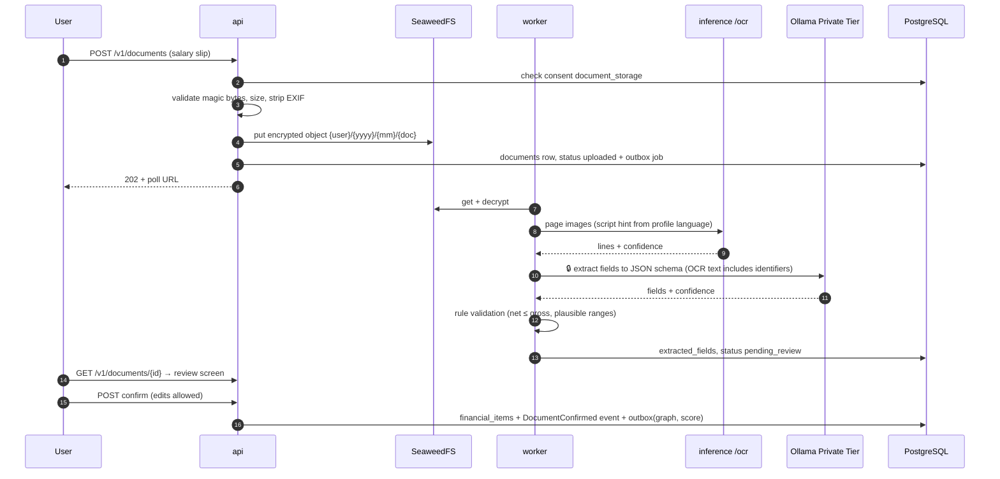
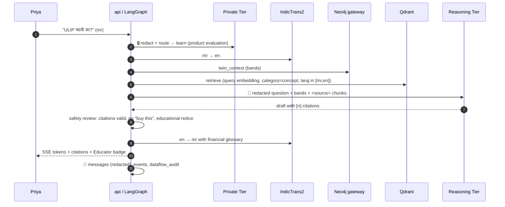
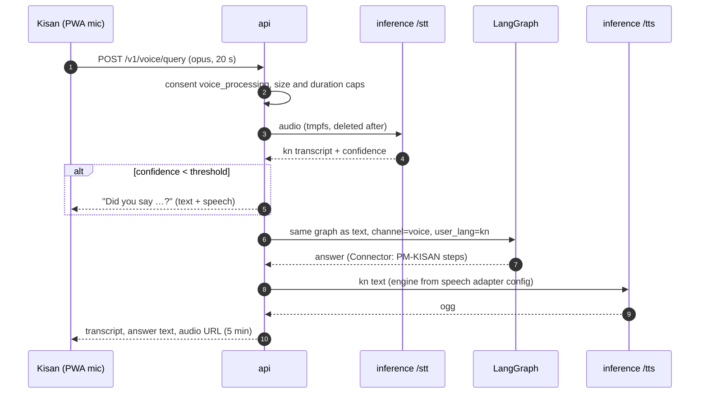
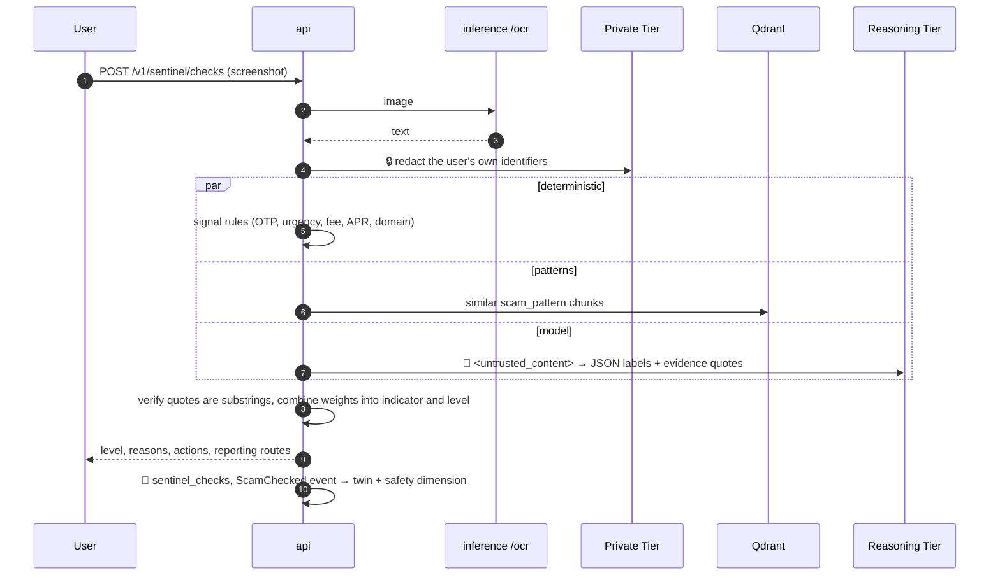
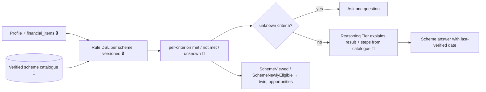
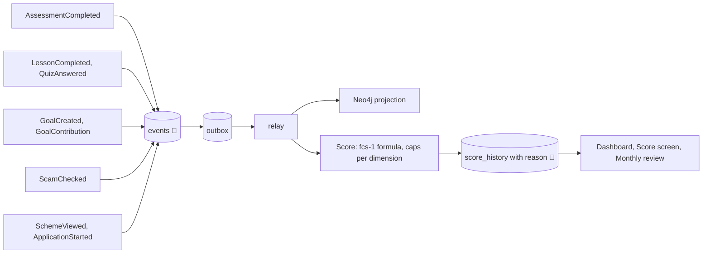
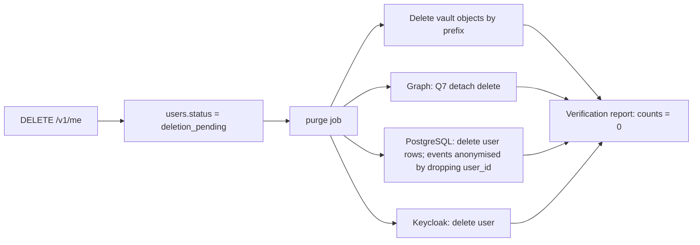

# Data Flow

**Version:** 1.0 (2026-11-05) | **Status:** Design
End-to-end flows for the 14-step journey (deck s11) and the five flows into the Confidence Engine (deck s29). Each flow states which tier sees what.

**Legend:** 🔒 Private Tier or deterministic code only · 🧠 Reasoning Tier sees redacted context · 💾 persisted

## 1. Journey overview

```mermaid
flowchart LR
  A[Register: Keycloak] --> B[Consent + profile 💾]
  B --> C{Path}
  C -->|documents| D[Upload 💾 vault] --> E[OCR + extraction 🔒] --> F[User confirms 💾]
  C -->|questionnaire| G[Dynamic questions 💾]
  F --> G
  G --> H[Twin created: outbox → Neo4j 💾]
  H --> I[Baseline score: deterministic 💾]
  I --> J[Goal Studio: calculators 🔒 + wording 🧠]
  J --> K[Learning, Sentinel, Connector, Ask]
  K --> L[Events 💾] --> M[Confidence Engine 💾] --> N[Monthly review 🧠]
  N --> K
```

## 2. Document onboarding

The Reasoning Tier never sees the document or its OCR text (FR-DOC-06).

## 3. Ask VAAKYA (text, Marathi)

## 4. Voice round trip (Kannada, Kisan)

Divya's screen reader can read the text answer, so TTS failure never blocks her (MASTER_PLAN s17).

## 5. Scam check

## 6. Goal planning

```mermaid
flowchart LR
  In[Goal: Emergency fund ₹90,000 by Oct 2027] --> P[Private Tier: parse params 🔒]
  P --> Snap[financial snapshot from PostgreSQL 🔒]
  Snap --> Calc[calculators: months, monthly saving, lean-month floor, feasibility 🔒]
  Calc --> Plan[(plans row: inputs + outputs 💾)]
  Plan --> Word[Reasoning Tier writes text with placeholders 🧠]
  Word --> Fill[fill placeholders from plan outputs]
  Fill --> Safe[safety: no stray numbers]
  Safe --> Out[Plan + Why this + next steps]
  Out --> Ev[GoalCreated event → twin, score 💾]
```

## 7. Scheme eligibility

## 8. Events into the Confidence Engine

## 9. Data deletion

## 10. What crosses each boundary

| Boundary | Allowed | Never |
|---|---|---|
| Browser → api | Typed inputs, files, audio | Tokens in JS-visible storage |
| api → Private Tier | Raw text, OCR, transcripts | - |
| Private → Reasoning Tier | Redacted English text, bands, tool outputs, public sources | Names, phone, Aadhaar, PAN, account numbers, addresses, raw documents |
| api → logs | Ids, timings, categories, HMAC user id | Content, figures, identifiers |
| Host → internet | Optional Google sign-in, OS updates, Let's Encrypt | Any user data |
