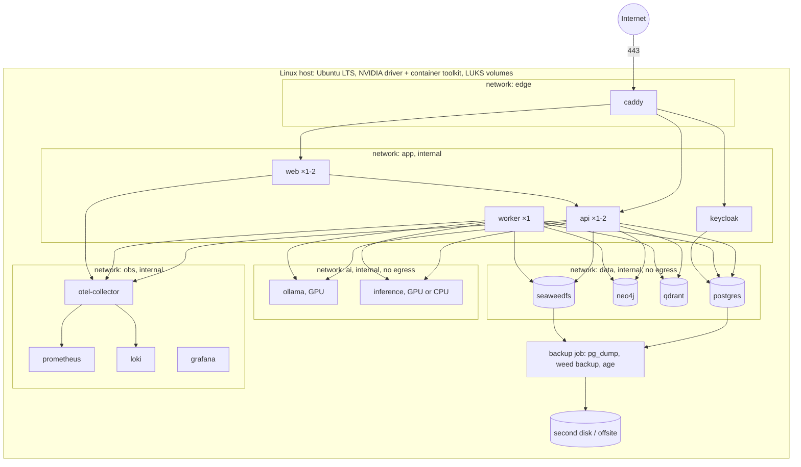

# Deployment Architecture

**Version:** 1.0 (2026-11-05) | **Status:** Design | **Location when built:** `04_APPLICATION/infra/`
**Baseline replaced:** ECS Fargate, ALB, CloudFront, CloudWatch and IAM (Executive Summary) are proprietary AWS services and are rejected by D-026. Fargate also cannot run GPU tasks. The self-hosted equivalents are below.

| AWS baseline | Self-hosted replacement |
|---|---|
| ECS Fargate | Docker Engine + Compose on a Linux host |
| ALB | Caddy reverse proxy |
| CloudFront | Caddy static caching + Next.js immutable assets with long cache headers |
| CloudWatch | OpenTelemetry Collector, Prometheus, Loki, Grafana |
| IAM | Docker secrets, Keycloak roles, Linux users, network segmentation |

## 1. Topology



Networks marked `internal: true` have no route to the internet. Only `caddy` joins `edge`. `keycloak` gets egress only if Google sign-in is enabled.

## 2. Compose services

| Service | Image | Resources (initial) | Health check |
|---|---|---|---|
| caddy | `caddy:2.11` | 64 MB | `/healthz` passthrough |
| web | built `vaakya/web` (Node 22 slim, standalone output) | 256 MB | `GET /api/health` |
| keycloak | `keycloak/keycloak:26.8.1` (`start --optimized`) | 1 GB | `/health/ready` |
| api | built `vaakya/api` (Python 3.13 slim, from T0.06 lockfile) | 1 GB | `/readyz` |
| worker | same image, `command: vaakya worker` | 1 GB | heartbeat row |
| ollama | `ollama/ollama:<pinned>` with GPU | GPU, 4 GB RAM | `/api/tags` |
| inference | built `vaakya/inference` (CUDA runtime, PaddleOCR, faster-whisper, TTS, IndicTrans2, e5) | GPU, 4 GB RAM | `/health` |
| postgres | `postgres:18` | 512 MB | `pg_isready` |
| neo4j | `neo4j:5.26-community`, heap 512 MB, page cache 256 MB | 1 GB | cypher-shell `RETURN 1` |
| qdrant | `qdrant/qdrant:v1.20.0` | 512 MB | `/readyz` |
| seaweedfs | `chrislusf/seaweedfs:4.50` (`server -s3`) | 256 MB | S3 `ListBuckets` |
| otel-collector, prometheus, loki, grafana | pinned | 1 GB total | built-in |

Measured idle on Linux (T0.06): PostgreSQL 40 MiB, Neo4j 519 MiB, Qdrant 28 MiB, SeaweedFS 63 MiB, Keycloak 788 MiB, about 1.4 GiB in total. GPU sharing is measured in T0.11.

## 3. GPU scheduling

```yaml
# excerpt, infra/compose.yaml
services:
  ollama:
    deploy: { resources: { reservations: { devices: [ { driver: nvidia, count: 1, capabilities: [gpu] } ] } } }
    environment: { OLLAMA_MAX_LOADED_MODELS: "1", OLLAMA_NUM_PARALLEL: "1", OLLAMA_KEEP_ALIVE: "10m" }
  inference:
    deploy: { resources: { reservations: { devices: [ { driver: nvidia, count: 1, capabilities: [gpu] } ] } } }
    environment: { STT_DEVICE: "cuda", OCR_DEVICE: "cpu", EMBED_DEVICE: "cpu", TTS_DEVICE: "cuda" }
```

Both containers see the same GPU. The API's queue (SYSTEM_ARCHITECTURE §6) prevents them from running at the same time. Device choices per engine come from T0.11 measurements.

## 4. Environments

| Environment | Where | Data | Differences |
|---|---|---|---|
| local | Developer laptop (Windows 11 + Docker Desktop, RTX 3050) | Synthetic personas only | `compose.override.yaml`: hot reload, ports exposed on localhost, Keycloak `start-dev` |
| staging | Production host, separate Compose project and volumes, or a second machine | Synthetic | Same images as production; release candidates promoted here first |
| production | Linux host with GPU | Real users only after the legal gate (NFR-PRIV-03) | Hardened settings, backups, alerts |

## 5. Build and release pipeline

```mermaid
flowchart LR
  PR[Pull request] --> CI[CI: lint, type check, unit, contract, licence check, pip-audit, npm audit, gitleaks, route-auth audit]
  CI --> Img[Build images, tag by git SHA, SBOM]
  Img --> Int[Integration tests with Compose services]
  Int --> Stg[Deploy to staging: scripted]
  Stg --> E2E[Playwright persona journeys + axe + blocked-internet test]
  E2E --> Prod[Promote same digests to production]
  Prod --> Smoke[Smoke: /readyz, login, one chat]
  Smoke -. fail .-> RB[Rollback: previous digests + migration down or restore]
```



- CI runs on GitHub Actions as a developer convenience (outside D-026 runtime scope). Every step also runs locally from `make` targets, so CI is replaceable.
- Deploy script: `infra/deploy.sh <env> <sha>` pulls or loads images, runs migrations, `docker compose up -d`, waits for health, runs smoke tests (NFR-MAINT-04).
- Migrations are backward-compatible for one release (expand, then contract), so rollback is image-only in most cases (NFR-AVAIL-02).
- Model weights are stored on the host and loaded by digest. Production never downloads models at runtime (NFR-LIC-02).

## 6. Observability

| Signal | Source | Store | Dashboards and alerts |
|---|---|---|---|
| Metrics | `prometheus-client` in api, worker, inference; cAdvisor; node exporter; DCGM exporter for GPU | Prometheus, 30 days | Latency p50/p90 per route and agent, queue depth and wait, GPU memory, tokens per user, error rate |
| Logs | structlog JSON → OTel collector | Loki, 30 days | Error spikes, safety-fallback rate |
| Traces | OpenTelemetry SDK | Tempo (optional, AGPL) or Loki trace ids only in R1 | Request → agent → tool → model spans |
| Uptime | Prometheus blackbox exporter | Prometheus | `/readyz` failures |

Alerts go to the owner by email through self-hosted SMTP or by a Grafana mobile contact point. Grafana is not exposed publicly.

## 7. Backup and restore

See DATABASE_ARCHITECTURE §6. Restores are rehearsed monthly on staging and recorded in `05_TESTING/` (NFR-AVAIL-03).

## 8. Scale path (NFR-SCAL-02)

| Step | Trigger | Change |
|---|---|---|
| 1 | GPU queue wait p90 > 30 s | Larger GPU (12-24 GB) on the same host. Configuration change only |
| 2 | CPU or RAM saturation | Move `ollama` and `inference` to a second GPU host; api calls them over TLS |
| 3 | More concurrent users | Two or more `api` and `web` replicas behind Caddy; sessions in PostgreSQL |
| 4 | Data growth | PostgreSQL streaming replica for reads; more SeaweedFS volume servers |
| 5 | Multi-host operations | Same images on Docker Swarm or Kubernetes (k3s, Apache-2.0). No code change |

## 9. Honest cost note

The software is free. Hosting a public service still needs an always-on machine with a GPU, electricity, internet access and a domain name. A laptop suits only a small private test (MASTER_PLAN s19).
