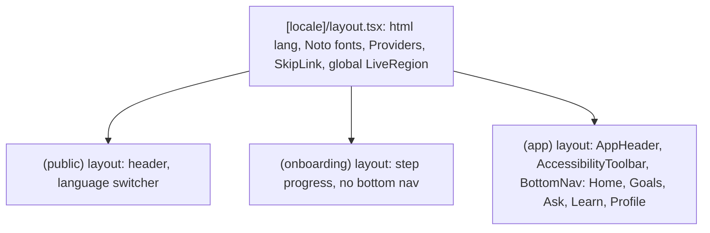
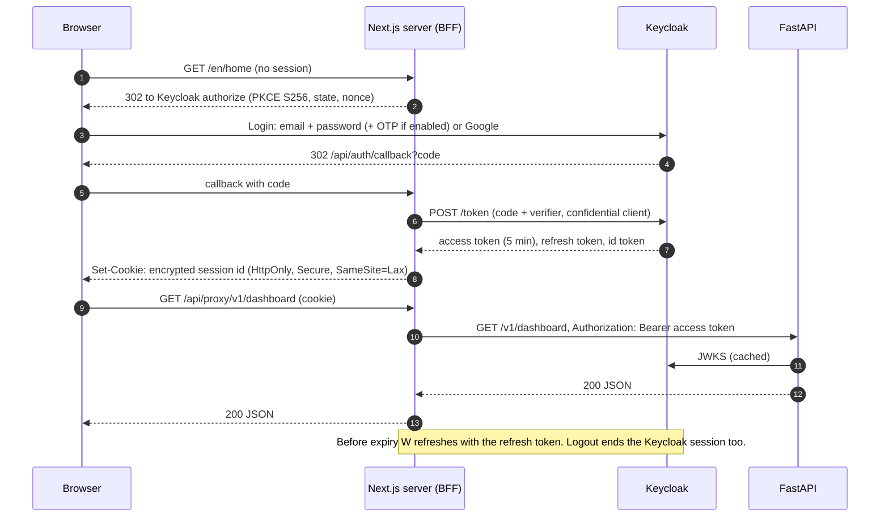

# Frontend Architecture

**Version:** 1.0 (2026-11-05) | **Status:** Design | **Location when built:** `04_APPLICATION/web/`
**Stack:** Next.js 16.4.5 (App Router), React 19.3.1, TypeScript 7.0.2 (strict), Tailwind CSS 4.3.4, ShadCN UI (Radix primitives), `next-intl`, PWA service worker. Builds verified in T0.06.

## 1. Design rules

1. **Server components by default.** Client components only for interaction, voice, streaming and forms.
2. **Every visual has a text equivalent** (FR-A11-02). Charts render a `<figure>` with a `<figcaption>` summary and a data table.
3. **No figure is computed in the browser.** Scores, plans and eligibility come from the API, so every screen shows the same number (NFR-ACC-02).
4. **Locale is part of the URL:** `/[locale]/...`, with locale one of `en`, `hi`, `mr`, `kn`. Adding a language is configuration (FR-LNG-05).
5. **The access token never reaches browser JavaScript.** It is held in the Next.js server session (BFF pattern).
6. **AI content is labelled**: an agent badge (FR-ORC-06), an AI notice (FR-SAF-01) and citations (FR-SAF-04).

## 2. Folder structure

```text
web/
  app/
    [locale]/
      layout.tsx                 # html lang, fonts, providers, skip link, live region
      (public)/                  # no session required
        page.tsx                 # Landing (UI-01)
        about-ai/page.tsx        # AI transparency, limitations (FR-SAF-01)
      (onboarding)/              # session required, profile incomplete
        consent/page.tsx
        profile/page.tsx
        path/page.tsx            # Upload documents or guided questionnaire (FR-ONB-05)
        documents/page.tsx       # Upload + extraction review (FR-DOC-05)
        assessment/[step]/page.tsx
      (app)/                     # session required, onboarding complete
        layout.tsx               # bottom navigation, accessibility toolbar
        home/page.tsx            # Dashboard (UI-03)
        goals/page.tsx, goals/new/page.tsx, goals/[id]/page.tsx   # Goal Studio (UI-04)
        ask/page.tsx, ask/[conversationId]/page.tsx               # Ask VAAKYA (UI-05)
        voice/page.tsx           # Voice Companion (UI-16)
        shield/page.tsx, shield/[checkId]/page.tsx                # Scam detection (UI-06)
        shield/learn/page.tsx    # Scam Knowledge Center (R3)
        schemes/page.tsx, schemes/[id]/page.tsx                   # Schemes and eligibility (UI-08, UI-09)
        learn/page.tsx, learn/[moduleId]/page.tsx, learn/[moduleId]/quiz/page.tsx
        score/page.tsx           # Confidence Score (UI-10)
        life-graph/page.tsx      # Life Graph (UI-11)
        opportunities/page.tsx
        reviews/page.tsx, reviews/[month]/page.tsx                # Monthly report (UI-13)
        documents/page.tsx       # Document Hub (R3)
        profile/page.tsx, settings/accessibility/page.tsx, settings/privacy/page.tsx
    api/
      auth/[...]/route.ts        # OIDC callback, logout, refresh (server only)
      proxy/[...path]/route.ts   # BFF: attaches access token, streams SSE from FastAPI
    manifest.ts                  # PWA manifest
    sw.ts                        # service worker source
  components/
    ui/                          # ShadCN copies: Button, Dialog, Tabs, Progress, Sheet...
    a11y/                        # SkipLink, LiveRegion, VisuallyHidden, ChartText, FocusOnRouteChange
    voice/                       # MicButton, ListeningState, SpeakButton, VoiceSummary
    ai/                          # AgentBadge, Citation, AiNotice, WhyThis, StreamingAnswer
    finance/                     # Money (₹ lakh/crore), ScoreGauge, GoalCard, RiskVerdict, EligibilityTable
    layout/                      # BottomNav, AppHeader, LanguageSwitcher, OfflineBanner
  lib/
    api/                         # typed client generated from OpenAPI, fetchers, SSE reader
    auth/                        # session helpers, server-only token access
    i18n/                        # next-intl config, number and date formatters
    a11y/                        # announce(), preferences store
  messages/{en,hi,mr,kn}.json    # interface strings
  tests/                         # Vitest unit, Playwright e2e and axe
```

## 3. Pages

| Route | Screen | Purpose | Main data | Requirements |
|---|---|---|---|---|
| `/` | Landing | Start assessment, try voice, language, accessibility, trust | static | FR-ONB-02 |
| `/consent` | Consent | Itemised consent before any upload | `GET/PUT /v1/me/consents` | FR-ONB-04 |
| `/profile` (onboarding) | Profile setup | Name, age, occupation, location, language, income type, accessibility | `PUT /v1/me/profile` | FR-ONB-03, -06 |
| `/path` | Path choice | Documents or questionnaire | - | FR-ONB-05 |
| `/documents` (onboarding) | Upload and review | Upload, OCR progress, confirm extracted fields | `/v1/documents*` | FR-DOC-01..05 |
| `/assessment/[step]` | Wizard | Dynamic questions, Back/Next, step progress, voice answers | `/v1/assessment*` | FR-ASM-01..05 |
| `/home` | Dashboard | Score, snapshot, goals, learning, schemes, scam risk, insight | `GET /v1/dashboard` | FR-DSH-01, -02 |
| `/goals` | Goal Studio | Create, edit, progress, roadmap, "why this" | `/v1/goals*` | FR-STR-01..09 |
| `/ask` | Ask VAAKYA | Chat with chips, tap-to-speak, streaming, history | `/v1/chat*`, `/v1/conversations` | FR-ASK-01..03 |
| `/voice` | Voice Companion | Listening state, language, prompts, recent | `/v1/voice/query` | FR-VOI-04 |
| `/shield` | Scam Shield | Upload screenshot or paste text, verdict, reasons, actions | `/v1/sentinel/checks*` | FR-SEN-01..09, -16 |
| `/schemes` | Schemes | Search, filter, eligibility status | `GET /v1/schemes` | FR-CON-01, -06 |
| `/schemes/[id]` | Scheme detail | Per-criterion eligibility, benefits, steps, last verified | `GET /v1/schemes/{id}`, `/eligibility` | FR-CON-03..05, -12 |
| `/learn` | Learning Academy | Modules, progress | `/v1/learning/*` | FR-EDU-04, -08 |
| `/learn/[id]/quiz` | Quiz | Questions, feedback, gaps | `/v1/learning/quizzes*` | FR-EDU-05 |
| `/score` | Confidence Score | Overall, five dimensions, actions, history | `GET /v1/score` | FR-FCS-01..06 |
| `/life-graph` | Life Graph | Accessible node list plus visual graph | `GET /v1/twin` | FR-FLG-10 |
| `/opportunities` | Opportunities | Consolidated feed | `GET /v1/opportunities` | FR-CON-10 |
| `/reviews/[month]` | Monthly report | Snapshot, achievements, alerts, focus | `GET /v1/reviews/{month}` | FR-COA-02 |
| `/settings/privacy` | Data controls | View, export, delete, withdraw consent | `/v1/me/*` | FR-SAF-06 |
| `/settings/accessibility` | Accessibility | Text size, contrast, motion, voice-first, low-literacy | local + `PUT /v1/me/preferences` | FR-A11-01, FR-LNG-04 |

## 4. Layouts



Route groups decide which guard applies. The `proxy.ts` (Next.js 16 middleware) checks the session cookie and onboarding state, and redirects to `/consent` or `/profile` when needed.

## 5. State management

| State | Where | Why |
|---|---|---|
| Server data (score, goals, schemes) | React Server Components fetch; client islands use **TanStack Query** | Cache, revalidation, optimistic goal updates |
| Chat and voice streams | Component state + `useReducer` per conversation | Streaming tokens and steps |
| Forms (assessment, goals, profile) | React Hook Form + Zod schemas generated from OpenAPI | Same validation as the API |
| Preferences (text size, contrast, voice-first, low-literacy) | `localStorage` mirror + `PUT /v1/me/preferences` | Apply before first paint; follow the user across devices |
| Session | HTTP-only cookie, server only | Token never exposed to scripts |
| Offline cache (R3) | Service worker Cache Storage + IndexedDB for learning packs | FR-OFF-02/03 |

No global client store is needed. If one appears necessary, use Zustand (MIT) and record it in the licence register.

## 6. API integration

- **Typed client:** `openapi-typescript` generates types from the FastAPI OpenAPI document at build time. A CI check fails on drift.
- **BFF proxy:** browser calls go to `/api/proxy/v1/...` on the same origin. The route handler reads the session, attaches `Authorization: Bearer`, forwards the `X-Request-ID` header and streams the response.
- **Streaming:** `POST /v1/chat` returns `text/event-stream`. The client reads events `queued`, `agent`, `token`, `citation`, `tool`, `final`, `error`.
- **Errors:** RFC 9457 problem details are mapped to localised messages. The `request_id` is shown so support can trace it.
- **Uploads:** `multipart/form-data` straight through the proxy, with a client-side check of type and 10 MB before sending.

## 7. Authentication flow



Session storage: an encrypted cookie holding a session id, with tokens kept server-side in an in-memory LRU, or in PostgreSQL when `web` has more than one replica.

## 8. Accessibility architecture

| Layer | Mechanism | Requirement |
|---|---|---|
| Structure | Landmarks (`header`, `nav`, `main`), one `h1` per page, skip link, logical heading order | FR-A11-03 |
| Route changes | `FocusOnRouteChange` moves focus to the `h1` and announces the page title | FR-A11-03 |
| Dynamic content | One polite and one assertive `LiveRegion` at the root, with `announce()`. Streaming answers announce once complete, not per token. Scam verdicts are assertive. | MASTER_PLAN s17 |
| Charts and gauges | `ChartText` gives a figcaption summary, a data table and a "Speak this" button. The SVG is `aria-hidden`. | FR-A11-02 |
| Life Graph | The primary view is a nested list, grouped by node type, with relationships as text. The visual graph is an enhancement. | FR-FLG-10 |
| Forms | Labels, `aria-describedby` errors, no placeholder-only labels, step progress announced as "Step 2 of 5" | FR-ASM-01 |
| Targets and colour | 44×44 px minimum, verdict and score bands use icon + text + colour | NFR-A11Y-03 |
| Private input | Sensitive fields can be entered by voice or keyboard alone. No CAPTCHA. Masked fields have a "reveal" toggle. | FR-A11-04 |
| Preferences | Text size (rem scaling), high contrast theme, reduced motion, voice-first mode (auto-reads answers), low-literacy mode (simpler strings set + icons) | FR-A11-01, FR-LNG-04 |
| Voice Summary | Each page exports a `summary()` server function. The button sends the text to `/v1/voice/speak`. It works without VAAKYA's TTS too, by reading the text into the live region for the user's screen reader. | FR-VOI-06 |
| Voice navigation | Intent "go to goals" from STT is matched to a route table on the client. | FR-VOI-05 |
| Scripts and numbers | Noto Sans, Noto Sans Devanagari, Noto Sans Kannada, self-hosted. `Intl.NumberFormat('en-IN')` for lakh and crore, with spoken forms from the API | NFR-I18N-01/02 |
| Testing | axe-core in Playwright for every P0 route, Lighthouse CI, manual TalkBack and NVDA scripts | NFR-A11Y-01/02 |

## 9. PWA

- Web app manifest with icons, `display: standalone`, theme colours, a `lang` per locale.
- Service worker: precaches the shell, fonts and locale messages. Network-first for API GETs, with an offline banner. Never caches personal API responses in R1. R3 adds encrypted IndexedDB caching and learning packs.
- Install prompt from the profile menu, not intrusive.

## 10. Testing

| Level | Tool | Scope |
|---|---|---|
| Unit | Vitest + Testing Library | Formatters (lakh/crore), ChartText, reducers |
| Contract | Generated OpenAPI types + `tsc` | API drift |
| E2E | Playwright | Four persona journeys, auth, uploads |
| Accessibility | `@axe-core/playwright`, Lighthouse CI, manual screen readers | P0 screens |
