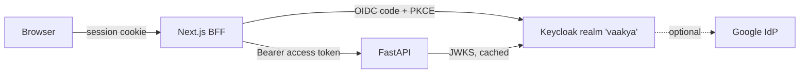

# Security Architecture

**Version:** 1.0 (2026-11-05) | **Status:** Design | **Requirements:** NFR-SEC-01..10, NFR-PRIV-01..03, FR-DL-*, FR-SAF-06
**Honesty rule:** the Executive Summary claims "AES-256" and "bank-grade" encryption. Do not repeat these claims in the product until the built system is verified to match (MASTER_PLAN s16). This document describes what will be built.

## 1. Threat model summary

| Asset | Threat | Main controls |
|---|---|---|
| Financial profile, documents | Cross-user access (IDOR) | Token-derived `user_id`, scoped repositories, PostgreSQL RLS, graph gateway, 404 on foreign ids, cross-user tests |
| Documents in vault | Theft from disk or backup | Envelope encryption per object, LUKS volume, encrypted backups |
| Identifiers in AI prompts | Leakage into logs or models | Private Tier redaction, minimal context, no prompt logging, audit of categories |
| Agents | Prompt injection from scam text, OCR and retrieved chunks | Content tagged as data, schema-bound outputs, no tool takes free text from untrusted content, evidence substring check |
| Accounts | Credential stuffing, takeover | Keycloak brute-force detection, optional TOTP, short-lived tokens, refresh rotation |
| Service | Abuse and resource exhaustion on a single GPU | Per-user and per-IP rate limits, queue caps, upload and audio limits |
| Supply chain | Malicious or vulnerable dependency | Lockfiles, `pip-audit`, `npm audit`, licence check, pinned image digests |
| Users | Harmful financial guidance | Safety review node, deterministic figures, educational framing |

A full STRIDE model and security testing come in T10.08 (NFR-SEC-10).

## 2. Authentication

| Control | Setting |
|---|---|
| Protocol | OIDC Authorization Code + PKCE (S256), confidential client `vaakya-web` |
| Access token | RS256 JWT, 5 minutes, audience `vaakya-api` |
| Refresh token | 30 minutes idle, 12 hours max, rotated on use, revoked on logout |
| Session cookie | `__Host-` prefix, `HttpOnly`, `Secure`, `SameSite=Lax`, encrypted (AES-GCM via `iron-session` or equivalent) |
| Passwords | Keycloak policy: length ≥ 10, not in breached list (Keycloak password blacklist file), PBKDF2/argon2 per Keycloak default |
| MFA | TOTP optional for users, mandatory for `operator` and `content_reviewer` |
| Brute force | Keycloak brute-force detection: temporary lockout after 5 failures |
| Accessibility | No CAPTCHA. Email verification by link. Screen-reader-tested login theme (FR-A11-04). |
| Verification in API | Signature, `iss`, `aud`, `exp`, `nbf`, `iat`, fixed `RS256`, `kid` lookup with refresh on unknown kid |

## 3. Authorisation

| Layer | Mechanism |
|---|---|
| Route | `Depends(current_user)` on every router. CI test lists all routes and fails if any lacks it, except the health allow-list. |
| Role | `require_role("operator")` for admin, `content_reviewer` for content approval |
| Service and repository | Every repository method takes `user_id` as its first parameter. There are no "get by id" methods without it. |
| PostgreSQL | RLS policies `USING (user_id = current_setting('vaakya.user_id')::uuid)` on user tables. The app role is not the table owner, so RLS cannot be bypassed. |
| Neo4j | Graph gateway with named, user-anchored queries only (FR-FLG-09) |
| SeaweedFS | Object keys prefixed by `user_id`. Vault checks the PostgreSQL row owner before every read. No presigned URLs to browsers. |
| Qdrant | No personal data, so no per-user control needed. Write access only for the worker. |
| Agent tools | Tools get `user_id` from state, set by the orchestrator from the token. Tool signatures do not accept `user_id` from the LLM. |

## 4. Secrets and API key protection

| Secret | Where it lives | Who reads it |
|---|---|---|
| PostgreSQL, Neo4j, SeaweedFS S3 credentials | Docker secrets (`/run/secrets/*`) | api, worker |
| Keycloak client secret | Docker secret | web |
| Session encryption key | Docker secret | web |
| Vault master key (KEK) | Docker secret, offline copy in the owner's password manager | api, worker |
| Log HMAC key | Docker secret | api |
| Inference shared secret | Docker secret | api, worker, inference |
| Google IdP secret (optional) | Keycloak admin, stored in Keycloak's DB | keycloak |

Rules: nothing in the repository or images (`gitleaks` in CI, NFR-SEC-04); `.env.example` has placeholders only; secrets rotated by replacing the secret and restarting; there are **no third-party AI API keys** because no external AI is used.

## 5. Encryption

| Data | In transit | At rest |
|---|---|---|
| Browser ↔ Caddy | TLS 1.2+ (1.3 preferred), HSTS, Let's Encrypt | - |
| Internal container traffic | Private Docker network, not exposed. TLS optional on one host, required if services are split across hosts. | - |
| PostgreSQL, Neo4j, Qdrant | - | LUKS-encrypted host volume |
| Documents and screenshots | - | AES-256-GCM per object (random DEK, wrapped by KEK) + LUKS volume |
| Backups | - | `age` encryption before copy |
| Voice audio | TLS | Not stored by default; temp files on `tmpfs` |

## 6. Input validation

- Pydantic models with `extra="forbid"` and constrained types on every route.
- Text length caps, NFC normalisation, control-character stripping.
- Server-side validation is authoritative. Client Zod schemas are for usability only.
- Path parameters typed as UUID or slug patterns.
- Outputs: React escapes by default. Markdown from the LLM is rendered through a sanitiser with an allow-list (no raw HTML, links only to `https:` and allow-listed hosts, `rel="noopener noreferrer"`).
- CSP: `default-src 'self'; script-src 'self' 'nonce-…'; img-src 'self' data: blob:; connect-src 'self'; frame-ancestors 'none'`.

## 7. File upload security (NFR-SEC-05)

```mermaid
flowchart LR
  Up[Upload] --> Cap[Caddy and API size caps: 10 MB]
  Cap --> Magic[Magic-byte check: PDF, PNG, JPEG only]
  Magic --> Decode[Decode in sandboxed worker: Pillow with pixel limit, pypdf page limit 20]
  Decode --> Strip[Re-encode images, strip EXIF and GPS]
  Strip --> PDF[PDF: reject JavaScript, embedded files, encryption]
  PDF --> AV[Optional ClamAV scan, GPLv2, separate container]
  AV --> Enc[Encrypt and store under user prefix]
  Enc --> Row[Record sha256, mime, size]
```

- The file name is never used as a key or shown back unsanitised.
- Parsing and OCR run in the `inference` or `worker` container with no network egress, a read-only root file system, a non-root user, and memory and CPU limits.
- Consent check before storage (FR-ONB-04).

## 8. Privacy controls

| Control | Implementation | Requirement |
|---|---|---|
| Consent | Itemised, versioned, append-only, checked before storage and processing | FR-ONB-04 |
| Minimisation | Bands in the twin and prompts; no raw documents to agents; voice not stored | NFR-PRIV-01, FR-DOC-06 |
| Tier separation | Private Tier redaction, audit of categories crossed | FR-DL-01..04 |
| No egress | Containers on an internal network with no default route; the blocked-internet test | FR-DL-05, NFR-LIC-02 |
| User rights | View, export (JSON + originals), delete across four stores with a deletion report | FR-SAF-06 |
| Retention | Scheduled purge per data class (DATABASE_ARCHITECTURE §2) | NFR-PRIV-02 |
| Logs | No PII, HMAC user ids, 30-day log retention | NFR-SEC-07 |
| Legal gate | No real user financial data until DPDP and SEBI advice is taken (T0.14) | NFR-PRIV-03 |

## 9. Prompt-injection defence (NFR-SEC-06)

1. Untrusted text (scam messages, OCR, documents, retrieved chunks) is always inside delimiters (`<untrusted_content>`, `<source id=n>`), with a system instruction that it is data.
2. Agents are fixed subgraphs, so untrusted text cannot choose tools.
3. Output is schema-validated. Fields that quote input are checked to be substrings of the input.
4. Tools never take URLs, file paths or user ids from model output.
5. The adversarial set in NFR-ACC-06 includes injection attempts in all four languages.

## 10. Abuse limits (NFR-SEC-09, NFR-COST-02)

| Bucket | Default limit |
|---|---|
| Chat and voice | 30 requests per user per hour, 200 a day |
| Sentinel checks | 20 per user per hour |
| Uploads | 20 per user per day, 200 MB total |
| Login | Keycloak brute-force detection |
| Queue | At most 2 queued GPU jobs per user; queue wait > 90 s returns 503 with a safe message |

## 11. Operational security

- Images pinned by digest, rebuilt weekly with patched bases (NFR-SEC-08).
- Containers run as non-root, `no-new-privileges`, dropped capabilities, read-only root where possible.
- Only Caddy publishes ports (80, 443). Admin consoles (Keycloak admin, Grafana, Neo4j browser) are reachable only through an SSH tunnel.
- Host: unattended security upgrades, firewall (`nftables`), SSH keys only, fail2ban.
- Security headers from Caddy: HSTS, CSP, `X-Content-Type-Options`, `Referrer-Policy: strict-origin-when-cross-origin`, `Permissions-Policy` (microphone only on `/voice`, `/ask`, assessment).
