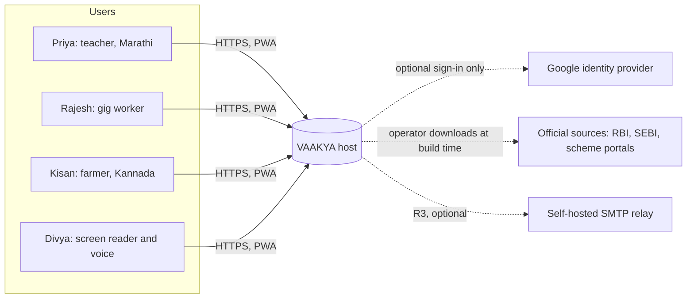
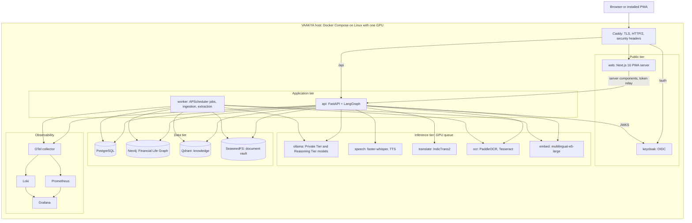

# System Architecture

**Version:** 1.0 (2026-11-05) | **Status:** Design. No application code exists yet. | **Owner:** Sanket Mali
**Inputs:** `MASTER_PLAN.md` sections 9-19, `DECISIONS_LOG.md` (D-003, D-010, D-013, D-020 to D-031), T0.06 results.

## Architecture document set

| Document | Covers |
|---|---|
| `SYSTEM_ARCHITECTURE.md` | This file: context, containers, quality attributes, key decisions |
| `FRONTEND_ARCHITECTURE.md` | Next.js PWA: pages, layouts, routing, state, API client, auth flow, accessibility |
| `BACKEND_ARCHITECTURE.md` | FastAPI: modules, services, routes, middleware, validation, errors, logging |
| `AGENT_ARCHITECTURE.md` | LangGraph orchestration, four agents, tools, Dual-LLM tiers, RAG, safety |
| `DATABASE_ARCHITECTURE.md` | PostgreSQL schema, Neo4j Financial Life Graph, Qdrant, SeaweedFS |
| `API_DESIGN.md` | REST endpoints with request and response schemas |
| `SECURITY_ARCHITECTURE.md` | Authentication, authorisation, secrets, encryption, uploads, privacy |
| `DEPLOYMENT_ARCHITECTURE.md` | Compose topology, environments, GPU scheduling, backups, monitoring |
| `DATA_FLOW.md` | End-to-end flows for each journey, including diagrams |
| `COMPONENT_DEPENDENCIES.md` | Versions, licences, internal module dependency rules |
| `ARCHITECTURE_COVERAGE.md` | Every one of the 208 tracked features mapped to its implementation strategy |

## 1. Architectural principles

| # | Principle | Source |
|---|---|---|
| P1 | **Free and open source only.** No paid or proprietary runtime service. | D-026 |
| P2 | **Deterministic core.** Money arithmetic, eligibility and the Confidence Score are tested code. LLMs explain and personalise. | D-013 |
| P3 | **Nothing user-related leaves the host.** All AI, speech, OCR and translation run on the VAAKYA host. | FR-DL-05 |
| P4 | **Two LLM tiers with minimum context.** Raw identifiers stay in the Private Tier. The Reasoning Tier sees redacted, minimal context. | D-003, D-025 |
| P5 | **Untrusted content is data, never instructions.** Documents, OCR text, retrieved chunks and scam messages. | NFR-SEC-06 |
| P6 | **Accessibility and language are structural**, not a later layer. | MASTER_PLAN s17 |
| P7 | **Educational, not advisory.** VAAKYA explains options and the user decides. | D-017 |
| P8 | **Single host first, portable later.** Docker Compose, stateless API and adapters let containers move to bigger hardware. | NFR-SCAL-01/02 |

## 2. Baseline and adopted stack

The Executive Summary named Firebase, AWS and Gemini. The owner's approved decision D-026 replaces them. Checks on 2026-11-05 also showed that the baseline pins cannot be used: `next@14.2.30` is deprecated for a security issue, and Coqui TTS 0.22.0 needs Python <3.12, so it cannot be installed alongside LlamaIndex 0.11.7. Evidence: `05_TESTING/evaluations/ARCH_BASELINE/baseline_version_check.txt`.

| Concern | Executive Summary baseline | Adopted (D-020, D-026, D-030) |
|---|---|---|
| Frontend | Next.js 14, TS 5.5, Tailwind 3.4, ShadCN, PWA | Next.js 16.4.5, React 19.3.1, TypeScript 7.0.2, Tailwind 4.3.4, ShadCN, PWA |
| Backend | Python 3.12.4, FastAPI 0.111.1 | Python 3.13 (3.12 also tested), FastAPI 0.162.0 |
| Orchestration | LangGraph 0.2.x | LangGraph 1.2.20 |
| LLM | Gemini 2.5 Pro (cloud) | Ollama with two open-licence models, selected by T0.03 |
| Retrieval | Qdrant 1.10.1, LlamaIndex 0.11.7, multilingual-e5-large | Qdrant 1.20.0, LlamaIndex 0.14.25, multilingual-e5-large |
| App data | Cloud Firestore | PostgreSQL 18 |
| Graph | Neo4j Community 5.23 | Neo4j Community 5.26 |
| Files | Firebase Storage | SeaweedFS 4.50 (S3 API) |
| Auth | Firebase Authentication | Keycloak 26.8 (OIDC) |
| Voice | Whisper Large-v3, Coqui TTS 0.22, IndicTrans2 | faster-whisper (Whisper large-v3), Indic Parler-TTS with eSpeak NG fallback (T0.07), IndicTrans2 at a pinned commit |
| OCR | PaddleOCR 2.7.3 | PaddleOCR 3.x with Tesseract fallback (T0.13) |
| Deploy | ECS Fargate, ALB, CloudFront, CloudWatch, IAM | Docker Compose on a Linux GPU host, Caddy, Prometheus, Loki, Grafana, Docker secrets |

## 3. System context

At runtime, no user data leaves the host. The only optional outbound call is Google sign-in, if enabled. Corpus sources are fetched by the operator at build time, not by user requests.

## 4. High-level container architecture

| Container | Responsibility | Scales by |
|---|---|---|
| `caddy` | Only public entry. TLS with Let's Encrypt, HSTS, CSP, request size caps | Single instance |
| `web` | PWA shell, server-rendered pages, service worker, OIDC client | Replicas, stateless |
| `keycloak` | Accounts, sessions, MFA, optional Google identity provider | Single instance, PostgreSQL-backed |
| `api` | REST API, auth verification, LangGraph orchestrator, deterministic engines | Replicas, stateless (NFR-SCAL-01) |
| `worker` | Scheduled and long jobs: extraction, monthly review, proactive triggers, ingestion | One instance, holds the APScheduler lock |
| `ollama` | Both LLM tiers. Loads and unloads models | GPU-bound |
| `inference` | One FastAPI service exposing `/stt`, `/tts`, `/translate`, `/ocr`, `/embed`. Logical names above | GPU-bound; CPU fallback per engine |
| `postgres` | System of record (D-010) | Vertical, then replica |
| `neo4j` | Graph projection of the twin, rebuilt from PostgreSQL | Vertical |
| `qdrant` | Public knowledge vectors only, no personal data | Vertical |
| `seaweedfs` | Encrypted raw documents and screenshots | Add volume servers |

## 5. Key quality attributes

| Attribute | Target (provisional until PH0 measures) | Mechanism |
|---|---|---|
| Text answer latency | < 20 s at p90 | Streaming SSE, small models, deterministic tools, inference queue |
| Voice round trip | < 45 s at p90 | Streamed STT, translation only when needed, short TTS output |
| Correctness | Calculators and eligibility pass table tests | Deterministic engines, LLM forbidden from arithmetic |
| Privacy | 0 identifiers in Reasoning Tier inputs on leakage set | Redaction gateway, audit log, egress test |
| Isolation | 0 cross-user reads | `user_id` from token only, gateway layers in every store |
| Availability | Degrade, never fabricate | Fallback model, safe failure messages, health checks |
| Accessibility | WCAG 2.2 AA on P0 screens | Semantic components, live regions, text equivalents |
| Portability | Same Compose file locally and in production | Adapters, environment configuration |

## 6. GPU resource model

One RTX 3050 with 6 GB is shared (D-025, R-02). The design assumes **one active GPU inference at a time**:

- All GPU work goes through an **inference queue** in the API (an `asyncio` priority semaphore, per engine class) and Ollama's own queue (NFR-SCAL-03).
- Priority: interactive voice and chat > Sentinel checks > document extraction > background jobs.
- Ollama `keep_alive` keeps the Private Tier model resident. The Reasoning Tier loads on demand.
- Whisper, OCR and embeddings can run on CPU when the GPU is busy, configurable per engine.
- The queue position is streamed to the client, so a user sees "waiting" rather than a frozen screen.

T0.11 measures whether this works. If it does not, the design keeps working on a larger GPU without code changes.

## 7. Cross-cutting decisions

| Topic | Decision |
|---|---|
| System of record | PostgreSQL. Neo4j is a rebuildable projection, written through the outbox (D-010). |
| Identity propagation | `sub` from the verified JWT becomes `user_id`. It is never taken from request bodies. |
| Event backbone | `events` table in PostgreSQL with an outbox pattern. No message broker on a single host. |
| Async model | FastAPI async handlers. LLM and engine calls are awaited through `httpx.AsyncClient`. |
| Streaming | Server-Sent Events for chat and voice progress. |
| Configuration | `pydantic-settings`, environment variables, Docker secrets for credentials. |
| Internationalisation | Interface strings by `next-intl`. AI output through the English pivot (D-028). |
| Time | Store UTC. Show Asia/Kolkata. |
| Money | Integer paise in storage. `Decimal` in Python. Never floats. |

## 8. Known architectural risks

| Risk | Effect on design | Fallback |
|---|---|---|
| Open models too weak on 6 GB (R-01) | Keep LLM output short and tool-bounded | Larger GPU, which is a hardware change only |
| GPU contention (R-02) | Queue and CPU fallback | Move inference containers to a second host |
| Kannada TTS or OCR unproven | Speech adapter per language | eSpeak NG, Tesseract, or text-only with the user's screen reader |
| Neo4j and PostgreSQL drift | Outbox and rebuild job | Full graph rebuild from PostgreSQL |
